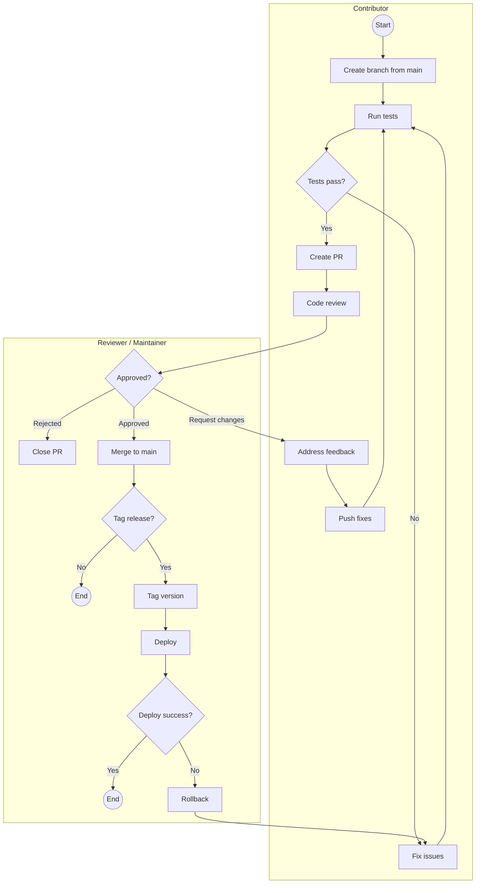

# Contribute to MDK

Thank you for your interest in contributing to [MDK][mdk-repo]. MDK is released under the [**Apache License 2.0**][license].

By contributing, you agree that:

- You retain copyright over your contributions
- You grant a perpetual, worldwide, royalty-free license for their use
- Contributions are provided **"AS IS"**, without warranty

This document outlines the contribution workflow for the MDK repository, from setting up your development environment to
submitting pull requests and participating in releases.

## Table of contents

- [Security](#security)
- [Release a Worker or app](#release-a-worker-or-app)
- [Monorepo structure](#monorepo-structure)
- [Get started](#get-started)
- [Development environment setup](#development-environment-setup)
- [Pull request workflow](#pull-request-workflow)
- [PR review](#pr-review)
- [Code standards](#code-standards)
- [Versioning and tagging](#versioning-and-tagging)
- [Links](#links)

## Security

If you discover a security vulnerability, do not report it in a public issue.

Please follow the private disclosure instructions in [SECURITY.md][security].

## Release a Worker or app

Ship your Worker or app from your own package or repository so other operators can add it to their sites.
Publishing makes an integration available to install; catalogue listings are maintained separately.

### Release your package

| Integration | Prepare and verify | Distribution |
| ----------- | ------------------ | ------------ |
| Worker | Follow [Worker development][integration-build-worker] and [integration testing][integration-test-worker] | Share your package or repository and its device configuration requirements |
| App | Follow [app packaging and publishing][integration-publish-app] | Ship the manifests, controllers, and built UI described by the app guide |

Include setup requirements, supported capabilities, configuration, permissions, and release information in your package's README.
The [CLI installation reference][integration-add-package] explains how operators add packages from npm or GitHub to their stack.

### List a Worker

Request a listing in the [supported Workers catalogue][integration-workers] by [opening an issue][integration-issues] with a link to your Worker contract,
or propose an entry in the [external Worker registry][integration-worker-registry] via your own PR. The [catalogue maintenance process][integration-catalogue-process] defines the source fields and verification used for that listing.

### List an app

Request a listing in the [supported apps reference][integration-apps] by [opening an issue][integration-issues],
or propose an entry in that reference via your own PR. Include the app's package or repository, purpose, installation instructions,
and requested permissions in either case. Maintainers review the proposed addition; publishing alone does not add a catalogue entry.

## Monorepo structure

MDK is a monorepo with separate backend `backend/` and frontend `ui/` workspaces:

Choose the backend or frontend workflow that matches the area you are contributing to.

### Root configuration must be domain-aware

The repo top level is a fixed set of domains ([`ui/`][ui-readme], `backend/`, [`docs/`][docs-readme], `examples/`) plus tooling and repo-meta files.
Shared root config (today just `.gitignore`) is read across all of them, so every pattern must be written so it cannot
silently match another domain's source:

- **Anchor anything that targets one domain's build or runtime output.** Use `/name/` for the repo root or `domain/**/name/`
for a subtree. A bare `status` / `store` / `tmp` / `Checklist*` matches a file or directory of that name *anywhere*,
including UI source such as [`ui/packages/ui-foundation/src/store/`][ui-foundation-store].
- **Keep per-domain ignores in that domain's own `.gitignore`** ([`ui/.gitignore`][ui-gitignore], the per-package backend `.gitignore`s),
not the root. Things like `dist`, `.turbo`, and `build` belong to a domain.
- **Lint/format/type config is domain-owned, not shared at the root.** [`ui/`][ui-readme] ships its own [`.oxlintrc.json`][ui-oxlint] /
[`tsconfig.base.json`][ui-tsconfig] / `.prettierrc`; backend uses `standard`. Do not add a root-level lint/tsconfig/prettier
that would apply across domains.
- **A genuinely shared convention is fine if it applies identically to every domain** - e.g. committing
`config/*.json.example` while ignoring the generated `config/*.json`. Note it as shared so the intent is clear.

## Get started

### Prerequisites

Before contributing, ensure you have the following installed:

- **Node.js** (version >=24)
- **Git** (latest stable version)
- **npm 11 [(< 12)][npm-version]**

## Development environment setup

<details>
<summary>1. Fork and clone</summary>

1. Fork [the repository][mdk-repo-git] on GitHub.
2. Clone your fork locally and navigate into the project directory:
```bash
git clone https://github.com/username/mdk.git
cd mdk
```

1. Add the upstream remote:

```bash
git remote add upstream https://github.com/tetherto/mdk.git
```

</details>

<details>
<summary>2. Stay in sync</summary>

Keep your fork in sync with the main repository. For example:

```bash
git fetch upstream
git merge --ff-only upstream/main   # fails loudly if main has diverged
```

</details>

### Install and build

From the repository root, install dependencies and build:

```bash
npm run setup       # install root and UI workspaces
npm run build       # build all domains
```

The root workspace contains backend packages, tools, and the demo site; the UI has its own workspace.
The root commands include both.

### Check your changes

Before submitting changes, run the checks relevant to your work from the repository root:

```bash
npm run test        # run tests
npm run lint        # run linters
npm run typecheck   # check types
```

Select checks according to the affected packages and behavior. Documentation-only changes need the
[documentation checks][docs-checks] rather than the full application test suite.

### Work on one domain

For a backend-only checkout, install the root workspace and scope checks to its members:

```bash
npm install
npm run lint --workspaces --if-present
npm test --workspaces --if-present
```

For frontend-only work, use the shared setup and build instructions, then start the development server from the UI workspace:

```bash
cd ui
npm run dev
```

The [UI contribution guide][ui-contributing] covers package-specific workflows.

## Pull request workflow

### Conventional types

MDK uses Conventional Commits-style types for both branch names and PR titles.

| Type       | Use for                                     |
| ---------- | ------------------------------------------- |
| `feat`     | New features                                |
| `fix`      | Bug fixes                                   |
| `docs`     | Documentation changes                       |
| `refactor` | Code refactoring without behavior change    |
| `test`     | Test additions or changes                   |
| `chore`    | Tooling, dependencies, repo maintenance     |
| `perf`     | Performance improvements                    |
| `style`    | Formatting only (no logic change)           |
| `ci`       | CI configuration changes                    |
| `build`    | Build system or external dependency changes |

### Branch naming convention

Create branches using the following pattern:

```bash
{type}/{short-description}
```

Where `{type}` is one of the [conventional types](#conventional-types).

#### Branch naming examples

```bash
# New feature
git checkout -b feat/mdk-new-device

# Bug fix
git checkout -b fix/timeout-handling
```

### Commit message template

The repository ships a commit message template at [`.gitmessage`][gitmessage] that pre-fills the
commit editor with the expected format (type, summary, body, and Task Id/Related PR references).
Enable it once per clone:

```bash
git config commit.template .gitmessage
```

This is a local convenience only — it is not enforced, and the [conventional types](#conventional-types)
above remain the source of truth for commit, branch, and PR naming.

### Pull request steps

1. Sync your local main with upstream `main`.
2. Create a branch from local `main`.
3. Make your code changes.
4. Write or update tests.
5. Run the applicable [checks for your changes](#check-your-changes), using [scoped commands](#work-on-one-domain) when appropriate.
6. Commit changes with meaningful messages.
7. Push your branch and open a Pull Request targeting the upstream `main`.

### PR checklist

Before submitting your PR, ensure that:

- [ ] Affected code builds using the [build instructions](#install-and-build)
- [ ] Applicable tests, linting, and type checks pass using the [check instructions](#check-your-changes)
- [ ] New features include tests
- [ ] Behavior, config, API, or CLI changes either include their documentation in the same PR or check the `docs-required`  
box in the PR template to request input from the docs maintainer
> Where documentation is included, you may request a review round from a maintainer with `docs-review`.
- [ ] Generated pages affected by the change are regenerated, using the command named in that file's `DO NOT EDIT` header (a Worker contract, a plugin manifest, or devkit component source each rewrite a different file)

> [!NOTE]
> The `docs-freshness` workflow enforces this on every PR as a required check: a stale
> generated page, a skipped generator, or a broken generator all fail the run. CI only detects the drift, it never regenerates
> for you. Run `npm run regenerate-docs` and commit the result in the same PR.

### PR title format

Use the following convention:

```bash
{type}({scope}): {description}
```

Where `{type}` is one of the [conventional types](#conventional-types) and `{scope}` is the affected area,
for example `miner` or `ui`.

Examples:

- `feat(miner): add Antminer S21 support`
- `fix(timeout): resolve action timeout handling`
- `docs(api): update stats documentation`

## PR review

All pull requests go through the following review steps:

1. **Automated checks**: Linting and tests must pass.
2. **Code review**: At least 2 maintainer approvals are required.
3. **Feedback resolution**: All requested changes must be addressed.
4. **Squash and merge**: Maintainers squash commits to keep history clean.

### Workflow diagram



## Code standards

MDK uses **StandardJS** style to keep the codebase consistent and easy to review across repositories.

Key rules:

- 2-space indentation
- No semicolons
- Single quotes for strings
- Space after keywords (`if`, `for`, `while`)
- No unused variables

## Versioning and tagging

MDK follows **Semantic Versioning**:

- **MAJOR** (`1.x.x`): breaking changes
- **MINOR** (`x.1.x`): new backward-compatible features
- **PATCH** (`x.x.1`): backward-compatible bug fixes

When the MDK team provides a release, they are cut from a `release/<version>` branch, verified in CI,
promoted to the public repo, then tagged. For the full release process and checklist, see [RELEASING.md][releasing].

Happy contributing, and thanks for helping improve MDK! 🚀

## Links

[mdk-repo]: https://github.com/tetherto/mdk/
<!-- docs@tether.io: external link — preserve URL -->

[security]: SECURITY.md
<!-- docs@tether.io: security → https://github.com/tetherto/mdk/blob/main/SECURITY.md -->

[license]: LICENSE
<!-- docs@tether.io: license → https://github.com/tetherto/mdk/blob/main/LICENSE -->

[npm-version]: docs/reference/environment.md#why-npm-stays-below-12
<!-- docs@tether.io: npm-version → reference/environment -->

[mdk-repo-git]: https://github.com/tetherto/mdk.git
<!-- docs@tether.io: external link — preserve URL -->

[releasing]: RELEASING.md
<!-- docs@tether.io: releasing → https://github.com/tetherto/mdk/blob/main/RELEASING.md -->

[gitmessage]: .gitmessage
<!-- docs@tether.io: gitmessage → https://github.com/tetherto/mdk/blob/main/.gitmessage -->

[integration-build-worker]: docs/guides/workers/build-a-worker.md
<!-- docs@tether.io: integration-build-worker → guides/workers/build-a-worker -->

[integration-test-worker]: docs/guides/workers/test-a-worker.md
<!-- docs@tether.io: integration-test-worker → guides/workers/test-a-worker -->

[integration-publish-app]: docs/guides/gateway/apps.md#publish-and-install-an-app
<!-- docs@tether.io: integration-publish-app → guides/gateway/apps#publish-and-install-an-app -->

[integration-add-package]: packages/cli/README.md#adding-and-validating-apps-and-workers
<!-- docs@tether.io: integration-add-package → https://github.com/tetherto/mdk/blob/main/packages/cli/README.md#adding-and-validating-apps-and-workers -->

[integration-workers]: backend/workers/docs/supported-workers.md
<!-- docs@tether.io: integration-workers → https://github.com/tetherto/mdk/blob/main/backend/workers/docs/supported-workers.md -->

[integration-issues]: https://github.com/tetherto/mdk/issues
<!-- docs@tether.io: integration-issues → https://github.com/tetherto/mdk/issues -->

[integration-worker-registry]: backend/workers/external-workers.json
<!-- docs@tether.io: integration-worker-registry → https://github.com/tetherto/mdk/blob/main/backend/workers/external-workers.json -->

[integration-catalogue-process]: docs/reference/maintainers/single-source-of-truth.md#supported-workers-catalogue
<!-- docs@tether.io: integration-catalogue-process → https://github.com/tetherto/mdk/blob/main/docs/reference/maintainers/single-source-of-truth.md#supported-workers-catalogue -->

[integration-apps]: docs/reference/supported-apps.md
<!-- docs@tether.io: integration-apps → reference/supported-apps -->

[docs-checks]: docs/reference/maintainers/linters.md
<!-- docs@tether.io: docs-checks → https://github.com/tetherto/mdk/blob/main/docs/reference/maintainers/linters.md -->

[ui-contributing]: ui/docs/CONTRIBUTING.md
<!-- docs@tether.io: ui-contributing → https://github.com/tetherto/mdk/blob/main/ui/docs/CONTRIBUTING.md -->

[docs-readme]: docs/README.md
<!-- docs@tether.io: docs-readme → https://github.com/tetherto/mdk/blob/main/docs/README.md -->

[ui-readme]: ui/README.md
<!-- docs@tether.io: ui-readme → https://github.com/tetherto/mdk/blob/main/ui/README.md -->

[ui-foundation-store]: ui/packages/ui-foundation/src/store/index.ts
<!-- docs@tether.io: ui-foundation-store → https://github.com/tetherto/mdk/blob/main/ui/packages/ui-foundation/src/store/index.ts -->

[ui-gitignore]: ui/.gitignore
<!-- docs@tether.io: ui-gitignore → https://github.com/tetherto/mdk/blob/main/ui/.gitignore -->

[ui-oxlint]: ui/.oxlintrc.json
<!-- docs@tether.io: ui-oxlint → https://github.com/tetherto/mdk/blob/main/ui/.oxlintrc.json -->

[ui-tsconfig]: ui/tsconfig.base.json
<!-- docs@tether.io: ui-tsconfig → https://github.com/tetherto/mdk/blob/main/ui/tsconfig.base.json -->
