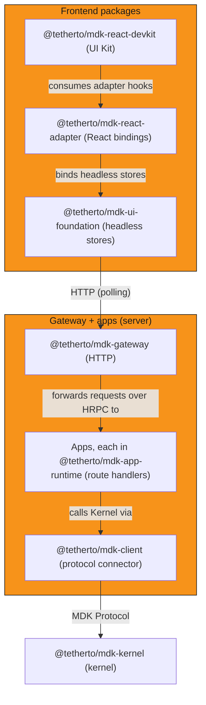

## Overview

The MDK App toolkit is the recommended development path for teams building MDK-powered applications. It is composed of three coordinated layers:

1. The [Gateway](#gateway-layer) backend.
2. [Apps](#apps).
3. The [frontend packages](#frontend-packages).

Not every layer is required for every consumer type.

MDK supports two primary consumer patterns:

- **Human operator UI**: a frontend application connects to the Gateway's REST API and polls it for live data, so the full three-layer toolkit applies
- **AI agent or headless consumer**: an AI agent connects over MCP to a standalone [`@tetherto/mdk-mcp`][mcp-readme] process that derives tools
  from an app's routes — the frontend packages are not required.

## Gateway layer

`@tetherto/mdk-gateway` is the backend component of the toolkit: an HTTP router that forwards each request to the app serving it and delivers an HTTP
interface for consumers that need those capabilities. The [Gateway's developer model][gateway-concept] covers its extension patterns, data access, auth design,
and Kernel connection.

## Apps

Apps are the extension mechanism the Gateway serves its routes from. Each app runs in its own process under `@tetherto/mdk-app-runtime`, and a Gateway
serves only the apps a stack declares in `spec.apps`; nothing auto-loads. The apps MDK ships and [any app you write][app-authoring] are declared the same way.
An app can also ship a UI module, which the dashboard shell loads at runtime and mounts alongside its own pages;
[what's an app][whats-an-app] covers the package's two halves and [the apps guide][app-authoring] covers writing the module.
Both halves type-check against one set of response types in the app's `plugin/types.d.ts`: the CommonJS controllers through JSDoc,
the UI through `import type`, as [the scaffold shares them][share-types].

## Frontend packages

These packages serve the **human operator UI** pattern: the application layer that connects to the Gateway's REST API and polls it for live data. If your consumer
is an AI agent connecting over MCP, this layer is not required.

Consuming applications add the workspace dependencies directly, and consuming the whole chain is the recommended path for operator UIs. The
[frontend package architecture][ui-architecture] carries the full dependency graph, build strategy, and package internals.

- **[`@tetherto/mdk-ui-foundation`][ui-foundation]**: framework-agnostic headless core with no React imports. Zustand vanilla stores, the TanStack `QueryClient`
  factory the app talks to its Gateway with, auth providers, device tag helpers, and shared type contracts
- **[`@tetherto/mdk-react-adapter`][react-adapter]**: React bindings for that core. `<MdkProvider apiBaseUrl={...}>` at the app root, plus one store hook per store
  (`useAuth`, `useDevices`, `useTimezone`, `useNotifications`)
- **[`@tetherto/mdk-react-devkit`][react-devkit]**: React UI library. [`src/primitives/`](../../ui/packages/react-devkit/src/primitives/) ships generic UI primitives
  built on Radix UI; [`src/domain/`](../../ui/packages/react-devkit/src/domain/) ships mining-domain components and presentation hooks

### Developer entry points

The toolkit can be adopted at any of the following entry points, from most batteries-included to least.

| Entry point      | Package                 | What ships | What you write | When to choose |
| ---------------- | ----------------------- | ---------- | -------------- | -------------- |
| UI Kit           | `@tetherto/mdk-react-devkit` (`/primitives` + `/domain` entrypoints) | Pre-built React components and shell layout | Data wiring, optional theming | You want a dashboard up fast |
| Framework adapter | `@tetherto/mdk-react-adapter` (React today; Vue/Svelte/WC planned) | `<MdkProvider>`, store hooks, TanStack Query re-exports | Your own components and layout | You have a design system already |
| UI Foundation    | [`@tetherto/mdk-ui-foundation`][ui-foundation-ref] | Zustand vanilla stores, `QueryClient` factory, auth providers, device tag helpers, the installed-app constants, API types | Framework bindings or headless utilities | You need store access outside React or are building a new adapter |
| Raw SDK          | `@tetherto/mdk-client` | MDK Protocol client, lazy connect over HRPC, reconnect on the next call after a failure | Everything above the wire: state, framework, UI | You are building a non-UI consumer (CLI, agent, backend service) |

## Architecture overview

## Next steps

- Understand the [Gateway surface][gateway-concept]
- [Build or extend with apps][app-authoring]
- Explore the [frontend package architecture][ui-architecture]

## Links

[gateway-concept]: ../../backend/core/gateway/README.md
<!-- docs@tether.io: gateway-concept → https://github.com/tetherto/mdk/blob/main/backend/core/gateway/README.md -->

[app-authoring]: ../guides/gateway/apps.md
<!-- docs@tether.io: app-authoring → guides/gateway/apps -->

[share-types]: ../guides/gateway/apps.md#share-response-types-with-the-ui
<!-- docs@tether.io: share-types → guides/gateway/apps#share-response-types-with-the-ui -->

[whats-an-app]: whats-an-app.md
<!-- docs@tether.io: whats-an-app → concepts/whats-an-app -->

[ui-architecture]: ../../ui/docs/ARCHITECTURE.md
<!-- docs@tether.io: ui-architecture → https://github.com/tetherto/mdk/blob/main/ui/docs/ARCHITECTURE.md -->

[ui-foundation]: ../../ui/packages/ui-foundation/README.md
<!-- docs@tether.io: ui-foundation → https://github.com/tetherto/mdk/blob/main/ui/packages/ui-foundation/README.md -->

[ui-foundation-ref]: ../../ui/packages/ui-foundation/README.md
<!-- docs@tether.io: ui-foundation-ref → reference/ui -->

[react-adapter]: ../../ui/packages/react-adapter/README.md
<!-- docs@tether.io: react-adapter → https://github.com/tetherto/mdk/blob/main/ui/packages/react-adapter/README.md -->

[react-devkit]: ../../ui/packages/react-devkit/README.md
<!-- docs@tether.io: react-devkit → reference/ui/components -->

[mcp-readme]: ../../backend/core/mcp/README.md
<!-- docs@tether.io: mcp-readme → https://github.com/tetherto/mdk/blob/main/backend/core/mcp/README.md -->
