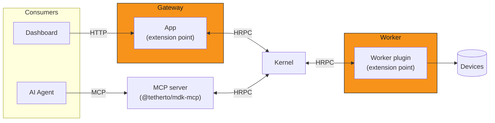

## How MDK works

MDK is built around a three tier ownership model:

- **Kernel is invariant** The Kernel provides small coordination layer every deployment runs unchanged: it routes validated commands to
  whichever Worker owns a device, and pulls telemetry back.
- **Extensions are yours** [Worker Plugins][workers-concept] wrap a device family; [apps][apps-guide] add
  HTTP routes, aggregation, and auth. Both are code you write, own, and publish, isolated from the Kernel and from each other. Nothing above the Gateway is
  required: a deployment can dispatch commands and pull telemetry with just [`@tetherto/mdk-client`][client-concept].
- **The UI devkit is optional** The [MDK App Toolkit][app-toolkit] is the supported path for teams that want one.

## The round trip

One request, traced end to end: an AI agent or a dashboard reaches an app's capability. A dashboard calls the
app's HTTP route directly; an [AI agent][ai-agents-docs] arrives instead through an MCP endpoint, a standalone
[`@tetherto/mdk-mcp`][mcp-readme] process that derives tools from that app's routes (the Gateway doesn't host the MCP itself).
Either way, the app builds its own [`@tetherto/mdk-client`][client-concept] and dispatches a command through it.
[Kernel][kernel-concept] resolves which Worker owns the target device, forwards the command over the Worker's own
connection, and relays the result back through the same path: app, then caller. Telemetry travels the same
round trip in reverse, on demand: the app's client asks Kernel for a device's telemetry, Kernel forwards that
pull to the owning Worker and relays the answer straight back. Kernel also runs its own scheduled telemetry/health pulls
on a fixed cadence, independent of any caller: the two are separate triggers into the same path, not one waiting on the
other.

Both extension points sit at the edges of this trip, never in the middle: a **Worker contract** teaches Kernel about
one device family (the contract declares the capability surface; the plugin's handlers implement it), and an
**app** teaches the Gateway a new route. Kernel itself never changes.

## The three tiers

**[Gateway][gateway-concept]**: an HTTP router in front of the Kernel. It reads each app's route table and forwards the
request to that app's own runtime process, running no app code itself. App runtimes dial Kernel for device traffic. For identity and
policy, the Gateway uses an in-process Kernel directly, or dials a Kernel in another process as its own service account.
Whoever connects is the active side, and Kernel never dials up. This is the tier where *user*-level authentication, aggregation,
and business logic live. Aggregation here means the cross-Worker queries no single Worker can answer — site hashrate,
average temperature, cross-rack efficiency — resolved in controller code, since Kernel computes none of them. Kernel's own
allowlist, when configured, gates which *connections* it accepts: a [transport-level check, not a user identity][security-boundaries].

**[Workers][workers-concept]**: the integration handlers between physical hardware and Kernel, and the source of truth
for that hardware's state. A Worker answers only when Kernel asks (identity, capabilities, telemetry, or a command) and
never calls Kernel unprompted.

**[Kernel][kernel-concept]**: the passive coordination layer. It never initiates contact with a caller; it discovers
Workers, routes commands to the one that owns a device, and pulls telemetry and health on its own cadence. It performs no
aggregation and stores no telemetry itself.

## How Kernel communicates with a Worker

Suppose Kernel needs a temperature reading from a Worker's device. Four separate questions explain how that
telemetry reaches Kernel:

1. **Discovery**: Which Worker should Kernel contact? Kernel learns the Worker's [public key][worker-discovery],
which identifies the Worker.
2. **Connection**: How can Kernel reach that Worker? [HyperDHT][deployment-connectivity] helps locate and
establish a connection to the peer (Worker) identified by that key.
3. **Permission**: Does the Worker allow Kernel to call it? The Worker checks the caller's key against its
[allowlist][worker-allowlist].
4. **Request**: What does Kernel want the Worker to do? Kernel sends a [telemetry pull][mdk-protocol] (in
our scenario, the temperature reading request) over HRPC, and the Worker replies.

Knowing a public key does not by itself grant a connection or permission to call; the allowlist check happens when
connections are established and requests are handled.

## Why HRPC?

Gateway to Kernel and Kernel to Worker communications use [Hyperswarm RPC (HRPC)][hrpc-glossary] to connect known backend peers through the same
encrypted, public-key-addressed interface, irrespective of whether they run together or on separate hosts. This suits a site's backend communication:
callers identify peers by key instead of addressing public HTTP endpoints.

> [!NOTE]
> The [HRPC connection model][hrpc-glossary] explains key addressing and encryption. The [deployment network requirements][deployment-connectivity]
> cover bootstrap reachability in every shape, and the [client transport reference][client-transport] explains request/response communication
> and recovery after a connection drops, including how that differs from replaying a command.

## What's authoritative vs. cached

Kernel's own store holds only its Worker registry, device capabilities, and the write-command log: never telemetry.
Telemetry is Worker-owned: a Worker persists its own device history, and every telemetry read anywhere above it (Gateway
app, dashboard, agent) is a live pull through that chain, not a read from a Kernel-side cache.

## The stack

Discover each layer's canonical docs:

| Layer           | Package                | Canonical doc                                          |
| --------------- | ---------------------- | ------------------------------------------------------ |
| Workers         | `@tetherto/mdk-worker-*`, one per vendor | [Device protocol adapters][workers-concept] |
| Worker Runtime  | `@tetherto/mdk-worker` | [Worker runtime][worker-runtime]                       |
| Kernel          | `@tetherto/mdk-kernel` | [Coordination kernel][kernel-concept]                  |
| Client SDK      | `@tetherto/mdk-client` | [Protocol connector][client-concept]                   |
| Gateway         | `@tetherto/mdk-gateway` | [HTTP surface and app router][gateway-concept]        |
| App runtime     | `@tetherto/mdk-app-runtime` | [One process per app, and the manifest format][app-runtime] |
| MCP server      | `@tetherto/mdk-mcp`    | [Tools for AI agents][mcp-readme]                      |
| App Toolkit     | Frontend packages      | [The supported development path][app-toolkit]          |

For the per-package detail in each workspace, read the [core package index][core-docs] and the [UI toolkit index][ui-index].
How many of each a deployment runs is covered by [scalability][scalability].

> [!NOTE]
> The [React adapter][react-adapter] and the [Node.js client][client-concept] do not mirror each other. Some Kernel operations,
> such as the [write-action flow][write-actions], are methods on the client, which an app calls and exposes as HTTP routes; a UI
> reads those routes with `useQuery` from the adapter. Start with the adapter for UI work and with the client for backend work.

## Next steps

- Understand [the integration model][integration-model]: what a Worker Plugin and an app each get to do
- Understand [the storage model][storage-model]: where state actually lives as you scale
- Understand the [security boundaries][security-boundaries]: what each tier does and does not authenticate, and what you must build
- Understand [what an app is][whats-an-app] in MDK terms
- Understand [scalability][scalability]: parallel Workers, parallel Kernels, and what's measured today
- Understand the [MDK App Toolkit][app-toolkit]: the recommended development path from Gateway backend to frontend packages
- [Connect an AI agent over MCP][ai-agents-docs]: the endpoint agents reach the fleet through, and the security envelope you supply

## Links

[worker-discovery]: ../../backend/workers/docs/architecture.md#discovery-model
<!-- docs@tether.io: worker-discovery → https://github.com/tetherto/mdk/blob/main/backend/workers/docs/architecture.md#discovery-model -->

[deployment-connectivity]: deployment-topologies.md#discovery-vs-transport
<!-- docs@tether.io: deployment-connectivity → https://github.com/tetherto/mdk/blob/main/docs/concepts/deployment-topologies.md#discovery-vs-transport -->

[worker-allowlist]: ../../backend/core/mdk-worker/README.md#caller-allowlist
<!-- docs@tether.io: worker-allowlist → https://github.com/tetherto/mdk/blob/main/backend/core/mdk-worker/README.md#caller-allowlist -->

[mdk-protocol]: ../../backend/core/kernel/README.md#mdk-protocol
<!-- docs@tether.io: mdk-protocol → https://github.com/tetherto/mdk/blob/main/backend/core/kernel/README.md#mdk-protocol -->

[client-transport]: ../../backend/core/client/README.md#transport-details
<!-- docs@tether.io: client-transport → https://github.com/tetherto/mdk/blob/main/backend/core/client/README.md#transport-details -->

[client-concept]: ../../backend/core/client/README.md
<!-- docs@tether.io: client-concept → https://github.com/tetherto/mdk/blob/main/backend/core/client/README.md -->

[react-adapter]: ../../ui/packages/react-adapter/README.md
<!-- docs@tether.io: react-adapter → https://github.com/tetherto/mdk/blob/main/ui/packages/react-adapter/README.md -->

[write-actions]: ../guides/gateway/write-actions.md
<!-- docs@tether.io: write-actions → guides/gateway/write-actions -->

[kernel-concept]: ../../backend/core/kernel/README.md
<!-- docs@tether.io: kernel-concept → https://github.com/tetherto/mdk/blob/main/backend/core/kernel/README.md -->

[gateway-concept]: ../../backend/core/gateway/README.md
<!-- docs@tether.io: gateway-concept → https://github.com/tetherto/mdk/blob/main/backend/core/gateway/README.md -->

[security-boundaries]: security-boundaries.md
<!-- docs@tether.io: security-boundaries → concepts/security-boundaries -->

[workers-concept]: ../../backend/workers/README.md
<!-- docs@tether.io: workers-concept → reference/worker -->

[hrpc-glossary]: ../reference/glossary.md#hyperswarm-rpc
<!-- docs@tether.io: hrpc-glossary → reference/glossary#hyperswarm-rpc -->

[mcp-readme]: ../../backend/core/mcp/README.md
<!-- docs@tether.io: mcp-readme → https://github.com/tetherto/mdk/blob/main/backend/core/mcp/README.md -->

[ai-agents-docs]: ../../backend/core/mcp/README.md#ai-agents-and-the-mcp-server
<!-- docs@tether.io: ai-agents-docs → https://github.com/tetherto/mdk/blob/main/backend/core/mcp/README.md#ai-agents-and-the-mcp-server -->

[storage-model]: the-storage-model.md
<!-- docs@tether.io: storage-model → concepts/the-storage-model -->

[integration-model]: the-integration-model.md
<!-- docs@tether.io: integration-model → concepts/the-integration-model -->

[apps-guide]: ../guides/gateway/apps.md
<!-- docs@tether.io: apps-guide → guides/gateway/apps -->

[app-runtime]: ../../backend/core/app-runtime/README.md
<!-- docs@tether.io: app-runtime → https://github.com/tetherto/mdk/blob/main/backend/core/app-runtime/README.md -->

[whats-an-app]: whats-an-app.md
<!-- docs@tether.io: whats-an-app → concepts/whats-an-app -->

[scalability]: scalability.md
<!-- docs@tether.io: scalability → concepts/scalability -->

[app-toolkit]: app-toolkit.md
<!-- docs@tether.io: app-toolkit → https://github.com/tetherto/mdk/blob/main/docs/concepts/app-toolkit.md -->

[worker-runtime]: ../../backend/core/docs/README.md#worker-runtime-tethertomdk-worker
<!-- docs@tether.io: worker-runtime → https://github.com/tetherto/mdk/blob/main/backend/core/docs/README.md#worker-runtime-tethertomdk-worker -->

[core-docs]: ../../backend/core/docs/README.md
<!-- docs@tether.io: core-docs → https://github.com/tetherto/mdk/blob/main/backend/core/docs/README.md -->

[ui-index]: ../../ui/README.md
<!-- docs@tether.io: ui-index → https://github.com/tetherto/mdk/blob/main/ui/README.md -->
