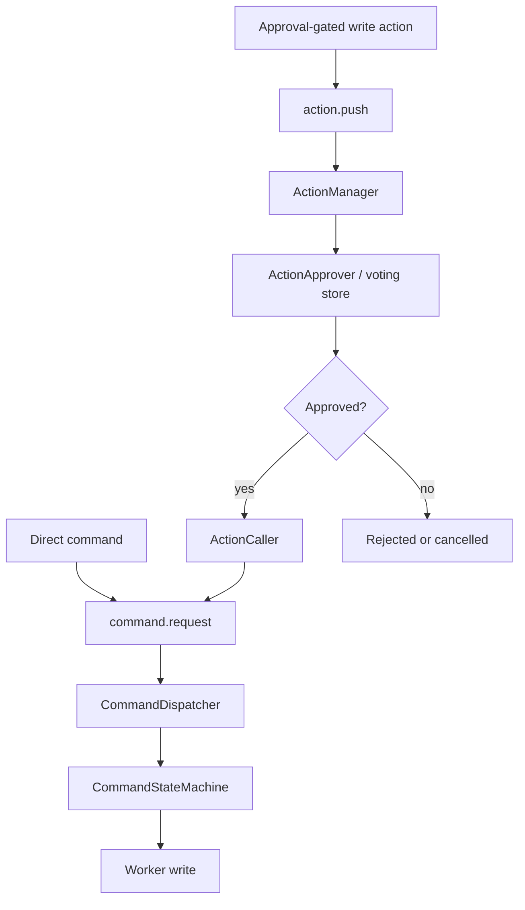
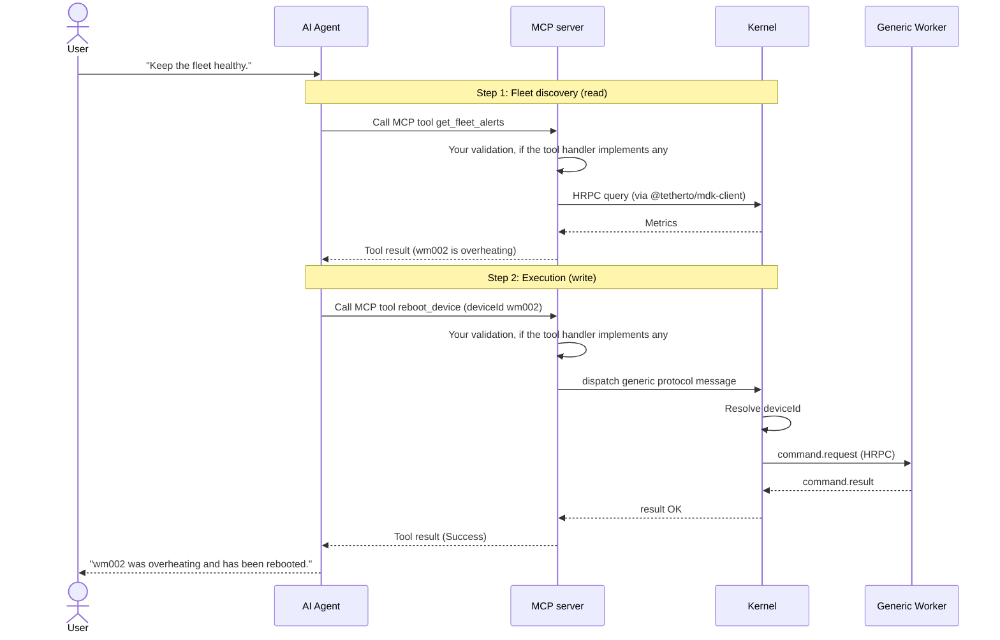
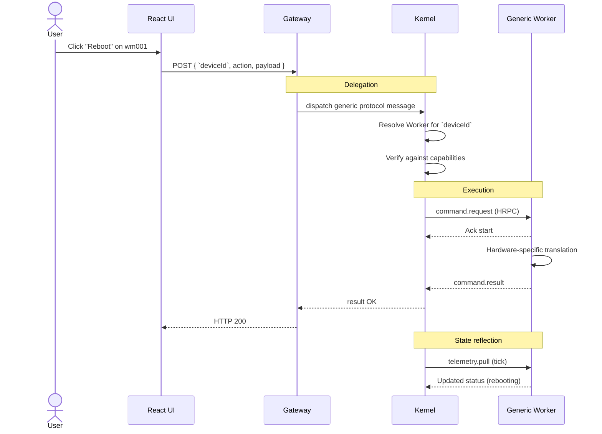

## Overview

This page covers authenticated requests, live reads, command dispatch, and approval-gated writes. It spans
the Gateway, Kernel, and Workers, but each layer owns a different responsibility.

Use this page to understand which layer receives a request, which layer validates it, and when a write becomes a command.

> [!NOTE]
> For package-level APIs and configuration, use the [Gateway README][gateway-readme], [Kernel README][kernel-readme], and [Worker README][worker-readme].

## Responsibility boundaries

**Gateway** owns the consumer-facing surface: it routes HTTP to the apps its stack declares, each in its own runtime process. It is also where
authentication belongs, though it implements none: that logic lives in [the app controllers you write][app-auth]. Browser UIs enter MDK
through the Gateway (they do not talk to Kernel directly). Agents can also reach MDK over MCP, a standalone
[`@tetherto/mdk-mcp`][mcp-readme] process that derives tools from an app's routes.

**Kernel** owns coordination: Worker registry, telemetry routing, health checks, command dispatch, command state, and the
write-action approval modules. Kernel trusts established callers; it does not validate user identity.

**Workers** own hardware integration. They declare capabilities, answer Kernel-initiated telemetry and state pulls, resolve candidate
write calls for approval-gated actions, and execute final commands against devices.

### Worker health is not device liveness

Two Kernel-side states describe a Worker, and neither one says anything about the hardware behind it.

| State | Set when | Means | Does not mean |
| --- | --- | --- | --- |
| `READY` | Kernel received the Worker's capability response | Kernel can route to this Worker's devices | Any device answered |
| `HEALTHY` / `SICK` / `DEAD` | The Worker process answered, or failed to answer, `health.ping` over HRPC | The Worker process is reachable | Any device is powered, hashing or reachable |

The health ping never contacts a device: the Worker answers it from memory with a constant `OK`. Kernel sends it every 5 seconds to
every `READY` Worker with a 3 second timeout; one or two misses mark the Worker `SICK`, three mark it `DEAD`, and one reply restores
`HEALTHY`. A `DEAD` Worker stays `READY` in the registry; Kernel stops routing commands to it and keeps pulling its telemetry.
`waitForWorkers` and `waitForDiscovery` test `READY` only. A Worker with every miner behind it unplugged is `READY` and `HEALTHY`.

Device-level truth lives in the telemetry channel, not in these states: each device's `status` and each channel's `{ error }` in a
telemetry pull, and for a command, `verification.state` (`VERIFIED` is the only Kernel-side proof the device reached the requested
state). Kernel keeps no per-device staleness or last-seen signal, `mdk status` reports component state only, and the built-in
`health` telemetry channel on `WorkerRuntimeV2` is a per-device identifier query unrelated to `health.ping`.

## Connection direction

The direction of each connection is intentional:

- Dashboards and UIs call the Gateway over HTTP; agents call the standalone MCP server over MCP
- The Gateway and the MCP server each dial Kernel over [Hyperswarm RPC (HRPC)][hrpc-glossary] through their own `@tetherto/mdk-client` — each a distinct Kernel caller, subject to [Kernel's allowlist][mcp-allowlist]
- Kernel discovers Workers, then initiates every Worker RPC
- Workers never initiate upstream calls to Kernel or the Gateway

The [deployment topologies][deployment-topologies] and [Workers discovery model][workers-discovery] pages cover how this changes
across single-process, local, and distributed deployments.

## Transport identity and admission

HRPC uses encrypted Noise connections with public-key identities. Kernel's HRPC public key identifies and addresses the
Kernel listener. Each caller has a separate public key that the listener receives during connection setup.

Kernel compares the caller's key with the allowlist and is fail-closed: an empty allowlist admits nobody. Admission only
lets a key connect; it grants nothing. What a caller may do is decided per request: every request but sign-in carries an
access token from the Kernel's token issuer, and Kernel checks it against `spec.rbac` in `mdk.yaml` as the action's resource
and verb, once per device the request touches ([caller admission and authorization][kernel-admission]). Both checks work the
same way whether the processes share a host or communicate across a network.

The Gateway dials with one persistent key, derived from a seed kept in its store and published as `status.rpcClientKey` in its
status file (`<root>/status/wrk-node-http-<port>.json`). That is the [value to allowlist][mcp-allowlist], and it survives restarts.

Transport identity is not user identity. The HRPC allowlist controls which backend processes may connect to Kernel, and it says nothing about the
person or agent behind a request. Establishing that is [the job of the app controllers][app-auth] serving people, browser applications, and agents.

## Request paths

### Read requests

Reads usually start in [an app controller][write-a-controller], pass through [the app's own `mdkClient`][client-in-app], and reach
[Kernel][kernel-readme] as queries against the registry, capabilities, telemetry, or state. Kernel routes Worker-owned reads down to the
relevant Worker and returns the result to the Gateway. Kernel-side storage is not where a series comes from: a controller that wants a
historical or aggregated series fans that same `mdkClient` out across every registered Worker and reads it from the Worker's own persisted
tail-log. An app does have a writable directory of its own, the `data/` subdirectory of its runtime's `storeDir`, reaching controllers as
`config.dataDir`.

> [!NOTE]
> For app controller mechanics, use the [app authoring guide][plugins-how-to].

### Direct commands

Direct commands are immediate writes that do not require approval. [The app controller][write-a-controller] performs whatever validation
you have written into it, then sends a [`command.request`][command-request] to Kernel. Kernel resolves the owning Worker, validates the
command against the Worker's capabilities, and hands the command to the crash-recoverable command state machine.

> [!NOTE]
> For command-dispatch module details, use the [Kernel README][kernel-readme].

### Approval-gated writes

Some writes are staged for approval before they become commands. This keeps direct commands available while adding a separate
review path for fleet-changing actions that need operator approval.

The Gateway may expose an HTTP actions surface through plugins. The Gateway checks the user's token against the route's
`spec.rbac` rule; the app then calls Kernel as its own service account (`app:<name>`), so Kernel checks the app's grant, not
the user. Kernel owns [`ActionManager`][action-manager], [`ActionCaller`][action-caller], and the target checks at the protocol layer: a push needs
`actions: write` and `devices: write` on every device it resolves to, and a vote needs `actions: vote` and `devices: write`
on every device of the stored action. For a caller with a token, the `authPerms` a payload carries are ignored; they only
apply to in-process calls. Workers answer
`write.calls.request` while Kernel resolves candidate writes, then execute the final `command.request` after the configured vote
thresholds are met.

A refused push or vote comes back as `ERR_KERNEL_ACTION_FORBIDDEN: may not write <device ids>`, naming the devices the
caller's rules do not cover; a push that matched no Workers is `ERR_KERNEL_ACTION_CALLS_EMPTY`. The voter is the caller's own
identity unless a rule grants `actions: delegate` (an app voting for the user it authenticated).

Direct command dispatch is checked the same way: `command.request` needs `devices: write` on the target device, or on every
device of the Worker for a Worker-scoped command, before Kernel checks the command against the Worker's declared
capabilities. Every attempt, refused ones included, goes to the write-command log.

> [!NOTE]
> For implementation steps, use the [write-actions how-to][write-actions-how-to]. For React hook names and exports, use the [React adapter README][react-adapter-readme].

## End-to-end scenarios

Two walkthroughs of the paths above, from the consumer down to the device and back: an AI agent driving the fleet over MCP,
and a human clicking a button in a dashboard.

### AI agent scenario

A user instructs the AI agent: *"Keep the fleet healthy."* The agent monitors continuously, catches `wm002` overheating, reboots it,
and notifies the user.

The Gateway hosts no MCP itself: the MCP server here is a standalone [`@tetherto/mdk-mcp`][mcp-readme] process that derives its tools from an app's routes, and the path below the MCP server is the same as for a direct HTTP call.

### Human UI scenario

A user clicks "Reboot" on device `wm001` in the UI.

Both scenarios take the [direct command](#direct-commands) path: neither reboot is staged for approval, so no vote is involved.

## Developer surfaces

The write-action flow is reachable from two different layers depending on where you are building.

| Layer | Package | How you call it |
|---|---|---|
| React / UI | [`@tetherto/mdk-react-adapter`][react-adapter-readme] | `useMutation` / `useQuery` against the HTTP routes your app exposes for actions; MDK ships no action hooks |
| Backend / Node.js | [`@tetherto/mdk-client`][client-readme] | Methods: `pushAction`, `pushActionsBatch`, `voteAction`, `cancelActionsBatch`, `getAction`, `getActionsBatch`, `queryActions` — send MDK Protocol envelopes directly to Kernel |

> [!IMPORTANT]
> The React hooks go through the Gateway, which checks the signed-in user against each route's `spec.rbac` rule. The `mdk-client` methods
> connect directly to Kernel and skip the Gateway, but not the policy: Kernel admits only allowlisted caller keys (an empty allowlist admits
> nobody) and checks every request's token against `spec.rbac`, so a backend client may do exactly what its service account is bound to.

## Next steps

- Build Gateway routes with the [app authoring guide][plugins-how-to]
- Secure a production site with the [security blueprint][security-blueprint]
- Submit and approve write actions with the [write-actions how-to][write-actions-how-to]
- Review the [Kernel modules][kernel-readme]
- Review Worker capabilities in the [Worker README][worker-readme]

## Links

[gateway-readme]: ../../backend/core/gateway/README.md
<!-- docs@tether.io: gateway-readme → https://github.com/tetherto/mdk/blob/main/backend/core/gateway/README.md -->

[kernel-readme]: ../../backend/core/kernel/README.md
<!-- docs@tether.io: kernel-readme → https://github.com/tetherto/mdk/blob/main/backend/core/kernel/README.md -->

[worker-readme]: ../../backend/workers/README.md
<!-- docs@tether.io: worker-readme → https://github.com/tetherto/mdk/blob/main/backend/workers/README.md -->

[react-adapter-readme]: ../../ui/packages/react-adapter/README.md
<!-- docs@tether.io: react-adapter-readme → https://github.com/tetherto/mdk/blob/main/ui/packages/react-adapter/README.md -->

[deployment-topologies]: deployment-topologies.md
<!-- docs@tether.io: deployment-topologies → concepts/deployment-topologies -->

[workers-discovery]: ../../backend/workers/docs/architecture.md#discovery-model
<!-- docs@tether.io: workers-discovery → https://github.com/tetherto/mdk/blob/main/backend/workers/docs/architecture.md#discovery-model -->

[action-manager]: ../../backend/core/kernel/README.md#actionmanager
<!-- docs@tether.io: action-manager → https://github.com/tetherto/mdk/blob/main/backend/core/kernel/README.md#actionmanager -->

[action-caller]: ../../backend/core/kernel/README.md#actioncaller
<!-- docs@tether.io: action-caller → https://github.com/tetherto/mdk/blob/main/backend/core/kernel/README.md#actioncaller -->

[command-request]: ../reference/protocol/messages.md#envelope
<!-- docs@tether.io: command-request → reference/protocol/messages#envelope -->

[write-a-controller]: ../guides/gateway/apps.md#22-write-a-controller
<!-- docs@tether.io: write-a-controller → guides/gateway/apps#22-write-a-controller -->

[client-in-app]: ../../backend/core/client/README.md#use-in-an-app
<!-- docs@tether.io: client-in-app → https://github.com/tetherto/mdk/blob/main/backend/core/client/README.md#use-in-an-app -->

[app-auth]: ../guides/gateway/apps.md#auth-and-permissions
<!-- docs@tether.io: app-auth → guides/gateway/apps#auth-and-permissions -->

[plugins-how-to]: ../guides/gateway/apps.md
<!-- docs@tether.io: plugins-how-to → guides/gateway/apps -->

[mcp-readme]: ../../backend/core/mcp/README.md
<!-- docs@tether.io: mcp-readme → https://github.com/tetherto/mdk/blob/main/backend/core/mcp/README.md -->

[write-actions-how-to]: ../guides/gateway/write-actions.md
<!-- docs@tether.io: write-actions-guides → guides/gateway/write-actions -->

[client-readme]: ../../backend/core/client/README.md
<!-- docs@tether.io: client-readme → https://github.com/tetherto/mdk/blob/main/backend/core/client/README.md -->

[hrpc-glossary]: ../reference/glossary.md#hyperswarm-rpc

[kernel-admission]: ../../backend/core/kernel/README.md#caller-admission-and-authorization
<!-- docs@tether.io: kernel-admission → https://github.com/tetherto/mdk/blob/main/backend/core/kernel/README.md#caller-admission-and-authorization -->

[mcp-allowlist]: ../guides/security/index.md#step-2-admit-the-gateway-to-kernel
<!-- docs@tether.io: mcp-allowlist → guides/security#step-2-admit-the-gateway-to-kernel -->

[security-blueprint]: ../guides/security/index.md
<!-- docs@tether.io: security-blueprint → guides/security -->
<!-- docs@tether.io: hrpc-glossary → reference/glossary#hyperswarm-rpc -->
