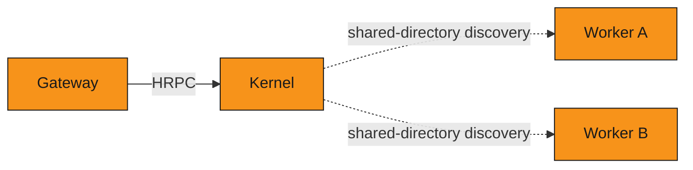
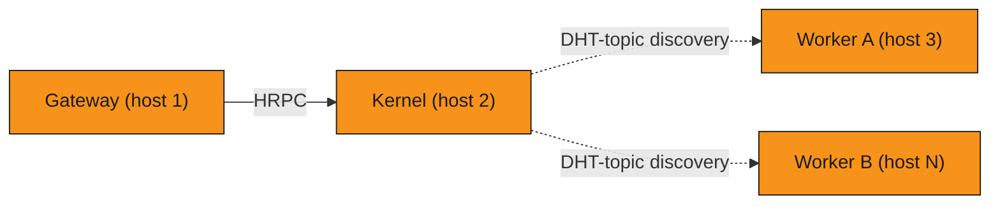

This page explains the three supported deployment shapes and when to pick each.

## Overview

MDK's runtime pieces — the [Kernel][architecture], the Gateway, and one or more Workers — can run together
in a single process or be split across several. This is a **packaging and operations** choice, and it's
independent of how MDK [scales logically][scaling] (adding Workers, adding sites).

> [!NOTE]
> If Kernel, Worker, manager, or thing are unfamiliar, read the [`glossary.md`][glossary] first.

## Connection model

Before choosing a shape, it helps to understand which components initiate connections:

- The Gateway dials Kernel — it is the active side of that connection, over [Hyperswarm RPC (HRPC)][hrpc-glossary] using the Kernel's public key (read from the well-known key file on the same host, or passed as `kernelKey` for a remote host)
- Kernel discovers Workers and initiates every RPC call — Workers are passive; they become reachable and wait
- Kernel initiates all telemetry pulls and commands. Workers answer those requests; they do not push telemetry. Workers still
  participate in DHT networking to make themselves reachable.

This directionality is what drives the transport and discovery configuration in each shape below.
For detail, see the [Workers discovery model][architecture-workers] and the [Gateway Kernel connection][gateway-kernel-connection].

## Discovery vs. transport

The [discovery, connection, permission, and request model][worker-communication] separates learning a Worker's key from reaching it
and being allowed to call it. Choosing a deployment shape changes how Kernel learns the key. It does not change the transport:
every hop uses [HRPC][hrpc-glossary] over HyperDHT.

A bootstrap node is an initial contact that helps a HyperDHT node join the network. HyperDHT uses public bootstrap nodes by default;
every component also accepts a private bootstrap list and a `dhtHost` bind interface, through its options, the `MDK_DHT_BOOTSTRAP`
and `MDK_DHT_HOST` service variables, or `spec.network.dht` in `mdk.yaml`. Learning a Worker's key locally does not remove this
transport dependency, so even a same-process deployment needs reachable bootstrap nodes. Bootstrap nodes help with connectivity; they
do not grant permission to call a Worker. The [local and air-gapped profile][private-dht] runs a private bootstrap and keeps every
process off the public network.

Every shape needs UDP access to its configured bootstrap nodes, public or private. The [network checks][network-checks] cover the
symptoms when that access is blocked.

| Shape          | How Kernel learns the Worker key                              | Transport                     | Network reach the transport needs                   |
| -------------- | ------------------------------------------------------------- | ----------------------------- | --------------------------------------------------- |
| Single process | In-process registration with `kernel.registerWorker()`        | HRPC over HyperDHT            | Outbound UDP to the bootstrap nodes, public or private |
| Local          | A shared directory on one machine, `<root>/.worker-keys`      | HRPC over HyperDHT            | Outbound UDP to the bootstrap nodes, public or private |
| Microservices  | A HyperDHT topic the Kernel and every Worker join             | HRPC over HyperDHT            | Outbound UDP to the bootstrap nodes, public or private, and peer reachability between hosts |

There is no host and port transport to fall back to. The only transport choices are which bootstrap list the DHT node uses, which
interface it binds, and which discovery mode supplies the keys. `mdk run` always uses local or in-process discovery; a stack that needs the DHT topic runs
[`worker.js`][worker-entry] or its own process script under a supervisor.

## The three shapes

### Single process

*Solid arrow: active connection initiated by the source. Dashed arrow: how Kernel learns the Worker key. Every arrow carries HRPC once connected.*

Kernel, the Gateway, and every Worker run inside one Node.js heap and event loop. Lowest footprint, simplest to start, nothing external to supervise.

### Local

*Solid arrow: active connection initiated by the source. Dashed arrow: how Kernel learns the Worker key. Every arrow carries HRPC once connected.*

Each service runs as its own OS process on the same machine. Kernel discovers Workers through a shared directory, so no DHT topic is
configured; the HRPC transport still runs over HyperDHT. The [supervised-services site guide][multi-how-to] demonstrates this as its default mode.

### Microservices

*Solid arrow: active connection initiated by the source. Dashed arrow: how Kernel learns the Worker key. Every arrow carries HRPC once connected.*

Each service runs as its own OS process or container, potentially on separate hosts, supervised by pm2 or Docker and discovered over a
DHT topic. The same guide's example switches to this shape by setting its `discovery` config field to `"dht"`.

## The trade-off

Pick **single-process** when:

- You are developing locally, running demos, or want a self-contained site for tests
- Footprint matters more than isolation (minimal or embedded deployments)
- You do not need supervisor-managed restarts

Pick **local** when:

- All services run on one machine and you want independent process restarts
- You want process isolation and independent restarts without managing a discovery topic and Worker key list

Pick **microservices** when:

- You want to allocate resources per service: CPU and memory limits per process or container
- Workers run on separate hosts from Kernel or the Gateway
- You are orchestrating many Workers across one or more hosts

### When DHT discovery earns its keep

DHT-topic discovery is the only mode that spans hosts, and it pays for itself when the site has any of these properties:

- Services move: a Worker that a scheduler restarts on another host, or a container that gets a new address, is found again
  through the topic with no config change
- Hosts have no DNS or static IPs: peers are addressed by public key, so nothing refers to an address that can change
- Identity must survive an IP change: a Worker with a persisted `storeDir` keeps the same key across restarts and moves, so the
  Kernel allowlist and the Worker allowlist stay valid
- Many Workers across many hosts: one topic replaces per-host key exchange

A topic is a rendezvous address, not a credential. Pair DHT mode with `discovery.workerKeys` on Kernel and `allowedKeys` on every
Worker; the [security blueprint][security-blueprint] walks through both.

### Locked-down managed site

A hosted or managed site usually has fixed hosts, a controlled network and a change process, so the properties above do not apply.
Pin keys in every case: `kernelKey` on the Gateway, `discovery.workerKeys` on Kernel, and `allowedKeys` on every Worker. Where Kernel
and its Workers share a host, pick local or single-process discovery and run no topic at all. Where they span hosts, the topic is
still how Kernel finds Workers, and the pinned `discovery.workerKeys` list is what admits them. Neither choice removes the DHT: the
transport still starts a HyperDHT node and needs outbound UDP to its bootstrap nodes. A site that blocks that traffic runs the
[local and air-gapped profile][private-dht], with a private bootstrap every component joins. What the DHT costs a managed site is
[measured against a known-endpoint RPC][transport-comparison] for setup, failures, latency and diagnosability.

## Where [`worker.js`][worker-entry] fits

The microservices shape is built on [`backend/core/mdk/worker.js`][worker-entry], a shared process entry compatible with pm2, Docker, or a direct `node worker.js`. It is driven by environment variables (`SERVICE`, and for a Worker `WORKER`/`TYPE`/`RACK` and `MDK_REPO_ROOT`) rather than CLI flags.
Its Workers join the DHT topic, so the Kernel must list their RPC keys in `discovery.workerKeys`; topic admission is closed by default. One [`worker.js`][worker-entry] runs per service, and the supervisor (pm2 or Docker) owns its lifecycle and resource limits. The [standalone `worker.js` install pattern][install-pattern] defines the per-Worker mechanics.

The single-process and local shapes both call the programmatic APIs directly: `getKernel()` and `startGateway()` from [`@tetherto/mdk-core`][mdk-readme],
and each Worker's own boot function (there is no single generic `startWorker`). Local mode passes `discovery: { mode: 'local' }` to `getKernel()` and
publishes each Worker's RPC key to the same shared directory with `publishWorkerKey()`. The [local Worker discovery][worker-discovery-local] section
covers how both sides resolve that directory and how Kernel picks up keys as they appear.

## Relationship to scaling

Topology is orthogonal to scale. [Logical scaling][scaling] is about *how many* Workers and Kernel kernels you run (parallel Workers, per-site kernels, multi-site oversight). Deployment topology is about *how those processes are packaged* on a given host. You choose both: for example, a production site typically runs multiple processes (this page) and multiple parallel Workers per kernel ([scaling][scaling]).

## Next steps

- Run [same-machine services with shared-directory discovery][worker-discovery-local]
- Run [a multi-Worker site as supervised services, from one machine up to a cross-host deployment][multi-how-to]
- Register [one miner before packaging a whole site][miner-how-to]
- Keep a stack off the public HyperDHT with [private bootstrap nodes][private-dht]
- Weigh [HRPC over HyperDHT against a known-endpoint RPC][transport-comparison] for a managed site

## Links

[architecture]: architecture.md
<!-- docs@tether.io: architecture → concepts/architecture -->

[architecture-workers]: architecture.md#the-three-tiers
<!-- docs@tether.io: architecture-workers → concepts/architecture#the-three-tiers -->

[worker-communication]: architecture.md#how-kernel-communicates-with-a-worker
<!-- docs@tether.io: worker-communication → concepts/architecture#how-kernel-communicates-with-a-worker -->

[gateway-kernel-connection]: ../../backend/core/gateway/README.md#kernel-connection
<!-- docs@tether.io: gateway-kernel-connection → https://github.com/tetherto/mdk/blob/main/backend/core/gateway/README.md#kernel-connection -->

[scaling]: scalability.md
<!-- docs@tether.io: scaling → concepts/scalability -->

[worker-entry]: ../../backend/core/mdk/worker.js
<!-- docs@tether.io: worker-entry → https://github.com/tetherto/mdk/blob/main/backend/core/mdk/worker.js -->

[mdk-readme]: ../../backend/core/mdk/README.md
<!-- docs@tether.io: mdk-readme → https://github.com/tetherto/mdk/blob/main/backend/core/mdk/README.md -->

[install-pattern]: ../../backend/workers/docs/install-pattern.md#standalone-via-workerjs
<!-- docs@tether.io: install-pattern → https://github.com/tetherto/mdk/blob/main/backend/workers/docs/install-pattern.md#standalone-via-workerjs -->

[multi-how-to]: ../guides/deployment/run-all-workers-site.md
<!-- docs@tether.io: multi-how-to → guides/deployment/run-all-workers-site -->

[private-dht]: ../guides/deployment/private-dht.md
<!-- docs@tether.io: private-dht → guides/deployment/private-dht -->

[miner-how-to]: ../guides/miners/index.md
<!-- docs@tether.io: miner-how-to → guides/miners -->

[worker-discovery-local]: ../../backend/workers/docs/architecture.md#local-mode
<!-- docs@tether.io: worker-discovery-local → https://github.com/tetherto/mdk/blob/main/backend/workers/docs/architecture.md#local-mode -->

[glossary]: ../reference/glossary.md
<!-- docs@tether.io: glossary → reference/glossary -->

[hrpc-glossary]: ../reference/glossary.md#hyperswarm-rpc
<!-- docs@tether.io: hrpc-glossary → reference/glossary#hyperswarm-rpc -->

[network-checks]: ../guides/miners/troubleshooting.md#example-does-not-print-a-kernel-key
<!-- docs@tether.io: network-checks → guides/miners/troubleshooting#example-does-not-print-a-kernel-key -->

[security-blueprint]: ../guides/security/index.md
<!-- docs@tether.io: security-blueprint → guides/security -->

[transport-comparison]: transport-comparison.md
<!-- docs@tether.io: transport-comparison → concepts/transport-comparison -->
