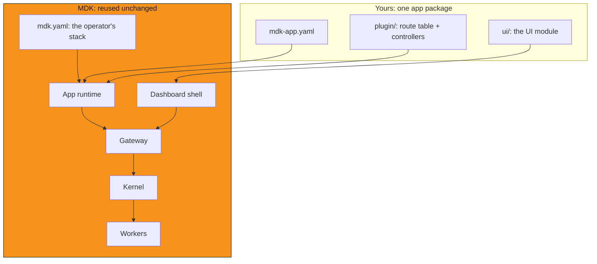

## Definition

An MDK app is a publishable package: a route table (`mdk-plugin.json`) with the controllers behind it, plus a UI module,
all described by an `mdk-app.yaml` manifest. You scaffold it with `mdk create app`, publish it to npm or
GitHub, and anyone installs it into their own stack with `mdk add app`.

An app is the unit of work you author and ship. A stack is what an operator runs, and it lists the apps it serves under
`spec.apps` in its `mdk.yaml`.

## Anatomy



What the package holds, as [`mdk create app`][app-guide] scaffolds it:

```text
apps/fleet/
├── mdk-app.yaml               # app manifest
├── package.json               # `files` ships the manifest, plugin/, and ui/
├── plugin/
│   ├── mdk-plugin.json        # route table
│   ├── lib/client.js          # the app's own mdk-client
│   └── controllers/summary.js # one module per route
├── ui-src/                    # UI source
└── ui/index.js                # the built UI module, committed
```

| Part            | What it is                                          | Who reads it              |
| --------------- | --------------------------------------------------- | ------------------------- |
| `mdk-app.yaml`  | The manifest: `id`, `version`, `displayName`, `permissions` (`[]` for none), and optional `description`, `config` and `main` | The app runtime and the operator, at boot and at `mdk validate app` |
| `plugin/`       | `mdk-plugin.json` declaring the routes, one controller module per route, and the app's own [`@tetherto/mdk-client`][mdk-client] | The app runtime, which serves the routes |
| `ui/`           | An ES module default-exporting `defineMdkApp({ id, displayName, routes, panels })`, built from `ui-src/` and committed | The dashboard shell, which mounts its pages and panels |
| `package.json`  | The npm identity, and the `files` list that decides what ships in the tarball | npm, and `mdk add app` |

[`mdk-app-demo`][demo-app] is a shipped app you can read end to end: its manifest, its route table, and one controller
per route. It serves routes only, so the `ui/` half is the one part it does not show; `mdk create app` scaffolds that.

## What's yours versus what's reused

Yours is the app package and nothing else. Kernel, the Gateway, the app runtime, the Workers your routes read from, and
the dashboard shell your UI mounts into are all reused unchanged, in every deployment
(see [architecture][architecture]).

A Worker Plugin is a separate thing you may also own: it integrates one device family, and
[the integration model][integration-model] covers how the two differ.

## What an app is not

- Not a stack: `mdk.yaml` is the operator's deployment unit, and it lists apps under `spec.apps` rather than being one.
- Not a fork of Kernel or the Gateway: you never edit their source to build an app.
- Not a Worker: a Worker speaks a device protocol downward to hardware; an app serves HTTP routes upward to people and agents.
- Not loaded by default: a Gateway serves only the apps its stack declares, so installing a package is not the same as serving it.

## Next steps

- Understand [the integration model][integration-model]: what a Worker Plugin and an app each get to do
- Understand [architecture][architecture]: how the pieces of a stack talk to each other
- Understand the [MDK App Toolkit][app-toolkit]: the layers a UI or headless consumer builds on
- [Build, publish, and install an app][app-guide] from an empty directory
- Look up [the terms in this page][glossary]

## Links

[architecture]: architecture.md
<!-- docs@tether.io: architecture → concepts/architecture -->

[integration-model]: the-integration-model.md
<!-- docs@tether.io: integration-model → concepts/the-integration-model -->

[app-guide]: ../guides/gateway/apps.md
<!-- docs@tether.io: app-guide → guides/gateway/apps -->

[glossary]: ../reference/glossary.md
<!-- docs@tether.io: glossary → reference/glossary -->

[demo-app]: https://github.com/tetherto/mdk-app-demo
<!-- docs@tether.io: demo-app → https://github.com/tetherto/mdk-app-demo -->

[mdk-client]: ../../backend/core/client/README.md
<!-- docs@tether.io: mdk-client → https://github.com/tetherto/mdk/blob/main/backend/core/client/README.md -->

[app-toolkit]: app-toolkit.md
<!-- docs@tether.io: app-toolkit → https://github.com/tetherto/mdk/blob/main/docs/concepts/app-toolkit.md -->
