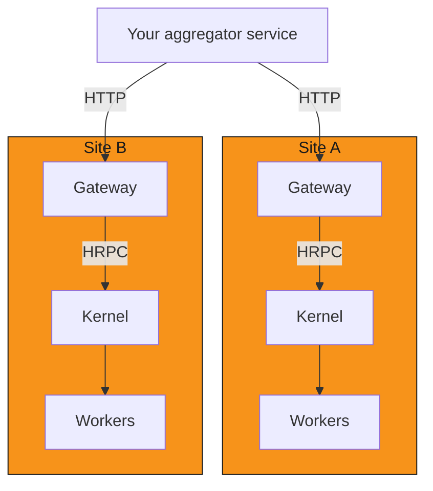

## TL;DR

- One Worker passed every threshold at 2,000 simulated devices and failed at 5,000: its collection cycle took 12.4 s against
  a 10 s interval and its process ran at 108% of one core. Run up to 1,000 devices per Worker until you have measured your own
- One Kernel served 2,000 devices across 4 Workers with every threshold green. At 5,000 devices across 5 Workers one run was
  green and the other failed on commands while its reads kept working: it rejected 2,105 action submits with
  `ERR_WORKER_NOT_ROUTABLE` and took 2,591 ms at p99 to accept the rest
- A Kernel accepts a single command in about 3 to 4 ms, but under 1,000 submits per second acceptance took tens to hundreds
  of milliseconds at p50 from 1,000 devices up
- A Worker or Kernel restart reached READY in 3.4 to 8.5 s, and device reads were served again within 3.5 s of that in 29 of
  32 drills. Wait for a device read, not READY
- In a fleet-wide device outage the `snap` channel reported the failure within about 30 ms, but the other metrics channels
  kept returning each device's last values for about 4.7 s, until the Avalon driver's 5 s cache expired
- One Gateway connects to exactly one Kernel. Multi-site views are built by your own application calling each site's Gateway
- Every number here comes from one developer workstation with simulated devices on loopback. Treat them as evidence about
  how MDK behaves, not as capacity guarantees for your hardware

## Overview

This page publishes representative results from the [benchmark harness][benchmark-harness], which boots real Kernel, Gateway,
Worker, and mock-device processes and measures them under load, through Worker restarts, Kernel restarts, and a fleet-wide
device outage. It also sets out the operating procedures and limits those runs support, including the current one-Kernel-per-Gateway
constraint and how multi-site aggregation works because of it.

The page separates four kinds of statement, and every number below is one of them:

| Kind                           | Meaning                                                                                         |
| ------------------------------ | ----------------------------------------------------------------------------------------------- |
| Measured result                | A value the harness recorded in these runs, on this hardware, with these settings               |
| Measured limit                 | A point where a measured profile crossed a pass/fail threshold or a run stopped working         |
| Recommended operating envelope | A deliberately conservative range derived from the measured results, with the reasoning stated |
| Architectural constraint       | A limit set by how MDK is built today, true on any hardware                                     |

A measured limit says where this setup stopped passing. It does not say where yours will: real devices answer more slowly
than a loopback mock, and a different host, device family, or operating interval moves every limit.

## Test setup

### Hardware and software

| Field          | Value                                                                    |
| -------------- | ------------------------------------------------------------------------ |
| Host           | Apple M3 Max, 14 cores, 36 GiB RAM, NVMe SSD (developer workstation)     |
| Reference tier | `custom`: not an `edge` or `site-server` reference host                  |
| OS             | macOS 15.8.1, darwin arm64                                               |
| Node.js        | v24.19.0                                                                 |
| MDK            | 0.12.1 at commit `2d71e224`, with no uncommitted harness changes         |
| Devices        | Simulated Canaan Avalon A1346 miners, `@tetherto/mdk-worker-avalon` mock |
| Network path   | Loopback, one mock TCP listener per Worker                               |
| Date           | 2026-10-27                                                               |
| Config hash    | `2f48ab70dc13` (`config/benchmark.config.json`)                          |

### Topology

Every profile runs the same process layout a supervised deployment uses: the mocks, the Kernel, the Gateway (with the harness's
`fleet-summary` app runtime in the same process), and each Worker run as separate OS processes on one host. The Kernel discovers
Workers through the shared-directory (`local`) mode. All devices behind one Worker share that Worker's mock listener.

### Load and operating parameters

| Parameter                       | Value                                                                                       |
| ------------------------------- | ------------------------------------------------------------------------------------------- |
| Soak before measuring           | 60 s                                                                                        |
| Kernel telemetry pull interval  | 10 s                                                                                        |
| Worker snap collection interval | 10 s (the production default is 60 s; the harness shortens it to get cycles in a short run) |
| Harness read sweep concurrency  | 500 devices in flight per Worker                                                            |
| Per-device request timeout      | 10 s (`thing.miner.timeout`)                                                                |
| Sequential latency samples      | 50 per row                                                                                  |
| Read saturation load            | 1,000 concurrent readers for 3 s                                                            |
| Action load                     | 1,000 `setPowerMode` submits per second, open loop, for 3 s                                 |
| Alert induction                 | Real Avalon temperature alert with its threshold forced below any reading                   |
| Gateway rate limit              | Off for the harness (see [Gateway rate limit](#gateway-rate-limit))                         |

### Profiles

Profiles are named by total devices and Worker count. Tables show the median where a profile ran more than once, with the
range where it matters.

| Profile                    | Devices | Workers | Runs |
| -------------------------- | ------- | ------- | ---- |
| `cap-10devices-1workers`   | 10      | 1       | 3    |
| `cap-100devices-1workers`  | 100     | 1       | 3    |
| `cap-500devices-1workers`  | 500     | 1       | 1    |
| `cap-1000devices-1workers` | 1,000   | 1       | 3    |
| `cap-1000devices-2workers` | 1,000   | 2       | 1    |
| `cap-2000devices-1workers` | 2,000   | 1       | 1    |
| `cap-2000devices-4workers` | 2,000   | 4       | 1    |
| `cap-5000devices-1workers` | 5,000   | 1       | 1    |
| `cap-5000devices-5workers` | 5,000   | 5       | 2    |

Before measuring, every profile checks that every device answers a metrics pull and stops if one does not. Every timed call
counts an error payload, a `FAILED` command, or a failed `snap` read as an error, never as a fast success.

## Results

### Capacity and throughput

Cycle time is one full read sweep of the busiest Worker's devices. Headroom is that cycle time divided by the 10 s interval:
below 0.7 is green, 0.7 to 1.0 amber, 1.0 or more red.

| Devices / Workers | Verdict                 | Cycle (ms) | Headroom | Reads/s at saturation | Actions accepted/s | Busiest process, avg CPU (% of one core) |
| ----------------- | ----------------------- | ---------- | -------- | --------------------- | ------------------ | ---------------------------------------- |
| 10 / 1            | green, amber in 1 of 3  | 444        | 0.044    | 33                    | 889                | Worker, 4.1                              |
| 100 / 1           | green                   | 338        | 0.034    | 190                   | 889                | Worker, 8.9                              |
| 500 / 1           | green                   | 382        | 0.038    | 749                   | 894                | Worker, 23.2                             |
| 1,000 / 1         | green                   | 758        | 0.076    | 926                   | 884                | Worker, 39.8                             |
| 1,000 / 2         | green                   | 438        | 0.044    | 1,479                 | 886                | Kernel, 22.5                             |
| 2,000 / 1         | green                   | 2,003      | 0.200    | 994                   | 828                | Worker, 65.3                             |
| 2,000 / 4         | green                   | 624        | 0.062    | 1,766                 | 863                | Kernel, 32.4                             |
| 5,000 / 1         | **red**                 | 12,403     | 1.240    | 737                   | 902                | Worker, 108.3                            |
| 5,000 / 5         | green in 1 of 2, **red** in 1 of 2 | 3,496 | 0.350 | 490 and 1,466     | 88 and 732         | Kernel, 28.7                             |

The 10-device amber run timed out 14 of its saturation reads (`ERR_MDK_REQUEST_TIMEOUT`). That is the load shape, not a fault:
1,000 readers against 10 devices queue about 100 reads per device, and reads to one device run one after another (see
[Read latency is driver-bound](#read-latency-is-driver-bound)).

The red 5,000 / 5 run kept its reads and collection green and failed both command thresholds. 2,105 of its 2,524 action
submits were rejected with `ERR_WORKER_NOT_ROUTABLE`, and the 419 it accepted took 2,591 ms at p99, against the 2,000 ms
action threshold. The Kernel returns that code when the target Worker is not `READY` or its
[health monitor][kernel-health-monitor] marks it `SICK` or `DEAD`. The monitor pings each Worker every 5 s with a 3 s timeout,
and a single missed ping marks the Worker `SICK` until a later ping succeeds. Reads do not pass through that check. The run
did not log Worker health states, so the missed pings are inferred from the code path rather than observed. One green and one
red run is not a stable result, so the page treats 5,000 devices on one Kernel as beyond the tested range.

Saturation throughput grows with device count until one Worker's CPU limits it. Splitting the same devices across more Workers
raises it: 1,000 devices served 926 reads/s on one Worker and 1,479 on two, and 2,000 devices served 994 on one Worker and
1,766 on four.

### Latency

All values in milliseconds. Device read, fleet summary, and single action accept go Client → Gateway → app runtime → Kernel →
Worker → device and back, one request at a time. Action accept under load is the harness calling the Kernel directly at 1,000
submits per second for 3 s.

| Devices / Workers | Device read p50 | p95   | p99   | Fleet summary p50 | p95    | Action accept, single p50 | p99  | Action accept under load p50 | p99              |
| ----------------- | --------------- | ----- | ----- | ----------------- | ------ | ------------------------- | ---- | ---------------------------- | ---------------- |
| 10 / 1            | 222             | 330   | 530   | 325               | 494    | 3.8                       | 14.7 | 1.0                          | 20.2             |
| 100 / 1           | 319             | 404   | 564   | 250               | 441    | 3.2                       | 14.6 | 1.1                          | 22.7             |
| 500 / 1           | 244             | 394   | 671   | 332               | 716    | 3.3                       | 17.8 | 4.4                          | 57.9             |
| 1,000 / 1         | 273             | 395   | 754   | 612               | 1,001  | 3.4                       | 16.9 | 29.9                         | 105              |
| 1,000 / 2         | 270             | 363   | 409   | 469               | 722    | 3.0                       | 23.6 | 30.6                         | 95.8             |
| 2,000 / 1         | 325             | 528   | 1,113 | 1,291             | 2,407  | 3.6                       | 12.8 | 17.0                         | 282              |
| 2,000 / 4         | 246             | 439   | 1,610 | 959               | 2,573  | 3.4                       | 59.9 | 58.7                         | 147              |
| 5,000 / 1         | 391             | 4,190 | 5,683 | 10,069            | 10,487 | 3.0                       | 8.8  | 85.9                         | 664              |
| 5,000 / 5         | 339             | 3,643 | 5,284 | 7,040             | 10,998 | 3.7                       | 67.2 | 423 and 951                  | 703 and 2,591    |

"Action accept" is the time for the Kernel to accept a command (`status: 'QUEUED'`). Nothing has reached the device at that
point; the harness does not time execution or confirm the outcome (see [What these results don't cover](#what-these-results-dont-cover)).
A single command is accepted in a few milliseconds at every fleet size. Under sustained submits, acceptance slowed as the fleet
grew: from 1,000 devices up it took tens of milliseconds at p50, and at 5,000 devices across 5 Workers it took 423 ms at p50 in the green run and 951 ms in the red one, whose p99 of 2,591 ms crossed the 2,000 ms
action threshold. The 5,000 / 5 row gives both runs, green first, because one run failed and a median would hide that.

The fleet summary is the harness app's aggregate route: it reads every device through the Kernel, so its latency tracks fleet
size. Every column except action accept under load rests on 50 samples per run, so treat p95 as the representative tail
there; the loaded column rests on about 2,500 to 2,700 accepted submits per run, 419 in the red 5,000 / 5 run.

#### Read latency is driver-bound

A single device read costs about 220 to 390 ms at p50 in every profile, and the Avalon driver appears to account for nearly
all of it. In an informal check outside the harness, the driver timed on its own against the same mock, with no Kernel,
Worker runtime, or HRPC in the path, took 318 to 333 ms for one full metrics pull. That check is not part of the harness and
its output is not among the published reports, so treat the split as an observation, not a measured result. Most of that
is the `snap` channel, which reads the device live on every call. The other channels read through the
driver's 5 s device-data cache (`fetchDeviceData`), so they only reach the device when their cached data is older than 5 s.

Two consequences follow:

- MDK's own hops add little to a single read; the device protocol sets the latency, and a real miner on a LAN will be slower
  than this loopback mock
- Reads to one device are serialized, so one device sustains about 3 reads/s. Saturation throughput scales with the number of
  devices, not the number of concurrent callers

### Resource use

Peak resident memory (RSS) per process, and the busiest Worker's values where there is more than one. CPU is the average over
the run as a percentage of one core.

| Devices / Workers | Kernel CPU | Kernel RSS (MiB) | Worker CPU | Worker RSS (MiB) | Gateway CPU | Gateway RSS (MiB) | All MDK processes, RSS (MiB) |
| ----------------- | ---------- | ---------------- | ---------- | ---------------- | ----------- | ----------------- | ---------------------------- |
| 10 / 1            | 3.7        | 399              | 4.1        | 233              | 0.8         | 149               | 779                          |
| 100 / 1           | 6.6        | 403              | 8.9        | 338              | 1.2         | 152               | 905                          |
| 500 / 1           | 14.0       | 436              | 23.2       | 584              | 2.3         | 208               | 1,227                        |
| 1,000 / 1         | 20.6       | 442              | 39.8       | 786              | 3.6         | 262               | 1,494                        |
| 1,000 / 2         | 22.5       | 442              | 21.9       | 567              | 3.7         | 282               | 1,852                        |
| 2,000 / 1         | 28.5       | 543              | 65.3       | 1,120            | 4.9         | 293               | 1,957                        |
| 2,000 / 4         | 32.4       | 440              | 20.9       | 546              | 5.8         | 316               | 2,923                        |
| 5,000 / 1         | 26.2       | 696              | 108.3      | 1,888            | 4.0         | 354               | 2,939                        |
| 5,000 / 5         | 28.7       | 481              | 26.5       | 785              | 4.8         | 339               | 4,558                        |

A Kernel, a Gateway, and one Worker with no devices together peaked at about 340 to 400 MiB. Each extra Worker process adds about
80 to 120 MiB before it owns any device, which is why splitting devices across more Workers raises total memory while lowering each
Worker's CPU. The Kernel's own CPU tracks total device count more than Worker count.

Each run soaked for 60 s, not 24 h, so memory and file-descriptor slopes in the per-profile reports are indicative and make no
growth or leak claim. On-disk growth is not characterized for the same reason.

### Failure drills

Each drill runs after the measurements finish, against the same on-disk stores, so identities survive the restart. Every time
counts from the moment the process is killed.

| Scenario          | Metric                                   | Up to 2,000 devices total   | 5,000 on one Worker | 5,000 across 5 Workers |
| ----------------- | ---------------------------------------- | --------------------------- | ------------------- | ---------------------- |
| Worker restart    | Kill to READY with all devices owned     | 3.4–5.5 s                   | 5.6 s               | 4.6–5.5 s              |
| Worker restart    | Kill to device reads served again        | 4.9–9.7 s (one run 20.8 s)  | 9.7 s               | 6.1–7.9 s              |
| Kernel restart    | Kill to READY (answers `getStatus`)      | 4.4–8.5 s                   | 4.6 s               | 4.1–6.4 s              |
| Kernel restart    | Kill to device reads served again        | 5.2–8.9 s                   | 6.7 s               | 5.5–6.7 s              |
| Fleet-wide outage | Kill to first failed read                | 12–32 ms                    | 24 ms               | 25–28 ms               |
| Fleet-wide outage | Kill to every metrics channel failing    | 4.6–4.7 s                   | 4.7 s               | 4.6–4.7 s              |
| Fleet-wide outage | Mocks restarted to reads served again    | 317–333 ms                  | 343 ms              | 324–334 ms             |
| Unresponsive devices | Worst-case sweep time (analytical)    | 10 s × ⌈devices / 500⌉      | 100 s               | 100 s                  |

READY and device reads being served again are separate events for both restarts: the restarted process answers status calls
before its devices are reachable through the Kernel again. The gap was under 3.5 s in 29 of 32 drills. One 10-device Worker restart took 20.8 s
to serve reads after reaching READY in 3.4 s, and the harness recorded nothing that explains it.

The outage drill stops the process serving every device's mock at once, so it can only make the whole fleet unreachable, never
one device. A stopped listener refuses connections immediately, and every failed read in the drill returned in under 10 ms.
The first failed read came from the `snap` channel, which reads the device live and reports the failure as
`{ success: false }`. The other channels kept returning each device's last values, including `status: "mining"`, until the
driver's 5 s device-data cache expired, after which every channel returned `ECONNREFUSED`. A device that hangs instead of
refusing is bounded by the 10 s per-device timeout; the analytical row multiplies that by the number of 500-device concurrency
waves, which is a worst case, not a measurement.

## Measured limits

| Limit                       | Evidence                                                                                            |
| --------------------------- | --------------------------------------------------------------------------------------------------- |
| Devices per Worker          | Green at 2,000 (headroom 0.200, Worker CPU 65%). Red at 5,000 (headroom 1.240, Worker CPU 108%)     |
| Concurrent reads per device | 1,000 readers on 10 devices timed out 14 reads in one of three runs; reads to one device are serialized |
| Devices per Kernel          | Green at 2,000 across 4 Workers. At 5,000 across 5 Workers, one green run and one red run           |
| Commands under host load    | In the red 5,000 / 5 run, 2,105 of 2,524 action submits rejected with `ERR_WORKER_NOT_ROUTABLE`, and the 419 accepted took 2,591 ms at p99 against a 2,000 ms threshold |

The Kernel never averaged more than about 32% of one core in any profile, so the harness found no Kernel CPU limit. The red
5,000 / 5 run points at the Kernel's Worker health check rather than its CPU: the rejection code comes from that check, and
reads, which skip it, stayed green.

## Architectural constraints

### One Kernel per Gateway

A Gateway connects to exactly one Kernel. `startGateway()` resolves a single `kernelKey` and hands that one key to every app
runtime it hosts, and `mdk.yaml` declares one Kernel per stack. No MDK component spans sites, federates Kernel registries, or
shares state between Kernels.

Add Kernels for separate sites, not to work around one site's device count: inside a site, scale by adding Workers, which the
[scalability model][scalability] covers.

### Multi-site aggregation lives in your application

A view across sites is built at the application layer: an aggregator or service of your own calls each site's Gateway over
HTTP and merges the responses.



The benchmark measured one site. For an aggregator, that means:

- Each site keeps its own capacity: size every site against the tables, independently
- A cross-site request is as slow as the slowest site it waits for. A fleet summary at 2,000 devices took about 1.3 s at p50
  on one site, so fan out to sites in parallel and set a per-site timeout
- A failure at one site leaves the others untouched, so the aggregator should return partial results with a per-site error
  rather than failing the whole request
- Each Gateway enforces its own rate limit on the aggregator (see [Gateway rate limit](#gateway-rate-limit))

### Gateway rate limit

The Gateway's default rate limit is 300 requests per minute per client IP. An aggregator, a dashboard backend, or any other
single client calling one Gateway hits it at 5 requests per second on average. The harness turns the limit off, because it is
itself a single client driving deliberate load. While the harness was being developed, runs of 500 devices or more with the
default on were observed to have every Gateway request after the first few hundred rejected with `429`; those runs are not
published, so treat this as an observation, not a measured result. Budget your aggregator's polling against the limit, or raise `rateLimit` on
the Gateway for that client's address.

## Recommended operating envelopes

These are starting points derived from the measurements, set below the measured limits on purpose. Validate them on your own
hardware with [the benchmark harness][benchmark-harness] before relying on them.

| Envelope                             | Recommendation                                                       | Reasoning                                                                                         |
| ------------------------------------ | -------------------------------------------------------------------- | ------------------------------------------------------------------------------------------------- |
| Devices per Worker                   | Up to 1,000                                                          | Half the largest green profile. Worker CPU 40%, headroom 0.076, restart to READY about 4 s       |
| Collection headroom on your hardware | Below 0.7, re-measured whenever the device count or interval changes | The harness threshold for green; real devices answer more slowly than the loopback mock          |
| Worker CPU                           | Keep the busiest Worker below 80% of one core                        | The one profile above that line also failed collection headroom                                  |
| Restart recovery                     | Expect device reads to fail for up to about 10 s after a Worker or Kernel restart | The slowest time to serve reads again was 9.7 s, apart from one 20.8 s Worker restart |
| Command submits                      | Retry `ERR_WORKER_NOT_ROUTABLE` with backoff                         | One missed 3 s health ping makes the Kernel reject every command to that Worker until a later ping succeeds |
| Callers per device                   | Do not plan on more than about 3 reads/s per Avalon device           | One metrics pull costs about 330 ms in the driver, and reads to one device run one at a time     |
| Devices per Kernel                   | Up to 2,000 until you have measured more on your own hardware        | The largest total that was green every time it ran. 5,000 was green once and red once            |
| Kernels                              | One per site                                                         | Architectural: one Kernel per Gateway, no cross-Kernel state                                     |

## Operating procedures

### Restart a Worker

1. Restart the Worker process under its supervisor; its identity comes from its store directory, so it re-registers with the
   same key.
2. Wait until Kernel status shows the Worker `READY` with its full device count. Expect about 4 to 6 s.
3. Do not treat `READY` as recovered. Poll a real device read on that Worker until it succeeds, which took 4.9 to 9.7 s from
   the kill in these runs, and 20.8 s once.
4. Reads and commands for that Worker's devices fail until then; other Workers' devices are unaffected.

### Restart the Kernel

1. Restart the Kernel process. It recovers from its own write-ahead log: [commands in flight settle as `TIMEOUT`][kernel-recovery]
   with `ERR_COMMAND_UNCONFIRMED` and are never re-sent, so reconcile them by reading the device state back.
2. Do not treat `READY` as recovered. Poll a real device read until it succeeds, which took 5.2 to 8.9 s from the kill in these
   runs.
3. Workers re-register with the restarted Kernel on their own, and the harness's existing Kernel client reconnected without
   being recreated. Restarting Gateways after a Kernel restart was not exercised.

### Respond to a site-wide device outage

1. Read `snap.success` in a metrics response to tell whether the device answered this read. It turned `false` within about
   30 ms of the outage.
2. Do not rely on the other metrics channels or the [device health channel][worker-health] for the first few seconds: for about
   5 s the cached channels keep returning the last values. The health channel marks a device unreachable only when no channel
   answers, so it keeps reporting `reachable` until the cache expires; the drill did not record it, this follows from the Worker
   runtime's code. After that every channel fails and the health channel records the error.
3. Expect a hung device to cost up to the 10 s per-device timeout per concurrency wave in each collection sweep; a refused
   connection costs almost nothing.
4. After devices return, reads succeed again within about 350 ms; no MDK process needs restarting.

### Scale a site

1. Add Workers before a Worker approaches 1,000 devices, or earlier if its CPU or headroom says so.
2. Keep one Kernel and one Gateway per site; a second Kernel means a second site.
3. Re-run the benchmark after the change, on the production host, with your device family.

## What these results don't cover

- Real hardware, a real network, or any device family other than the Avalon A1346 mock
- Hung devices: the outage drill only measures refused connections; the hung case is analytical
- Command execution: action rows time Kernel acceptance only, and the approval workflow is not exercised
- Worker health states over time: the harness does not record when the Kernel marks a Worker `SICK`
- More than one host, DHT discovery, or the MCP server
- Growth and leaks: every run soaked for 60 s, not the 24 h the [capacity template][capacity-template] requires for those claims
- The Gateway rate limiter under load, which the harness turns off
- Statistical confidence: most profiles ran once or twice, and the p99 of every one-at-a-time latency rests on 50 samples

## Reproduce these results

The per-profile reports, in the [capacity template][capacity-template] format, are in
[`backend/tests/benchmark/published/2026-10-27-m3max/`][published-reports]. They come from harness commit `2d71e224`; numbers
from a harness before that commit are not comparable, because earlier versions measured a fleet whose devices were all offline.
To produce your own:

```bash
cd backend/tests/benchmark
./setup-config.sh            # copies config/benchmark.config.json.example; fill in its hardware block
node processes/run-process.js --id cap-1000devices-2workers --devices 1000 --workers 2 --sweep representative
```

Run the host with sleep disabled for the whole run (for example `caffeinate -i` on macOS): a suspended host stalls every
process and invalidates the profile.

## Next steps

- [Benchmark your site](benchmark-your-site.md): run the same harness on your own hardware and device count
- [Capacity and metrics template](capacity-metrics-template.md): what every profile records and the pass/fail thresholds
- [Scalability](../../concepts/scalability.md): devices per Worker, Workers per Kernel, and Kernels per site
- [Deployment topologies](../../concepts/deployment-topologies.md): how these processes are packaged on one or many hosts

## Links

[benchmark-harness]: ../../../backend/tests/benchmark/README.md
<!-- docs@tether.io: benchmark-harness → guides/deployment/benchmark-your-site#overview -->

[capacity-template]: capacity-metrics-template.md
<!-- docs@tether.io: capacity-template → guides/deployment/capacity-metrics-template -->

[scalability]: ../../concepts/scalability.md
<!-- docs@tether.io: scalability → concepts/scalability -->

[worker-health]: ../../../backend/core/mdk-worker/README.md#device-health-channel
<!-- docs@tether.io: worker-health → https://github.com/tetherto/mdk/blob/main/backend/core/mdk-worker/README.md#device-health-channel -->

[kernel-recovery]: ../../../backend/core/kernel/README.md#commandstatemachine
<!-- docs@tether.io: kernel-recovery → https://github.com/tetherto/mdk/blob/main/backend/core/kernel/README.md#commandstatemachine -->

[kernel-health-monitor]: ../../../backend/core/kernel/README.md#healthmonitor
<!-- docs@tether.io: kernel-health-monitor → https://github.com/tetherto/mdk/blob/main/backend/core/kernel/README.md#healthmonitor -->

[published-reports]: ../../../backend/tests/benchmark/published/2026-10-27-m3max/README.md
<!-- docs@tether.io: published-reports → https://github.com/tetherto/mdk/blob/main/backend/tests/benchmark/published/2026-10-27-m3max/README.md -->
