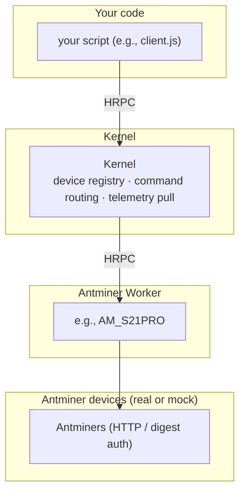

This page provides explanations for terms that new users may not be familiar with.

- [Stack](#stack-and-hardware-terms)
- [HRPC](#hyperswarm-rpc)

## Stack and hardware terms

This section explains the terms you need to familiarize yourself with, using an Antminer rack as an example.

| Term | What it is | Lives at |
| --- | --- | --- |
| **Kernel** (Orchestration Kernel) | The pull-only kernel that owns the device registry, routes commands, and pulls telemetry on its own cadence — it performs no aggregation itself | [`backend/core/kernel/`][kernel-package] |
| **Gateway** | The developer-owned HTTP entry point between non-Node clients (UI) and Kernel. Required for browser and HTTP consumers; AI agents reach Kernel through the standalone MCP server instead. Not used in the in-process Antminer-rack example below | [`backend/core/gateway/`][gateway-package] |
| **App** | A publishable package serving HTTP routes and, optionally, dashboard UI: an [`mdk-app.yaml`][app-manifest] manifest, an app route table with its controllers, and a `ui/` module. Installed into a stack with `mdk add app` and declared under `spec.apps` | [`mdk-app-demo`][demo-app] |
| **App route table** | The declarative `mdk-plugin.json` inside an app: its routes, their handlers, and their HTTP methods and paths, read by the app runtime to mount them and by the Gateway to know where to forward | [`mdk-app-demo/mdk-plugin.json`][demo-app-manifest] |
| **Worker** | A device-family translator. Speaks the MDK Protocol upward to Kernel and the vendor's native API downward to one device family (one miner brand, one container type, one pool API). | [`backend/workers/`][worker-readme] |
| **Worker Plugin** | The executable device integration: [`mdk-contract.json`][contract-schema] plus its handler files, loaded from a package directory by `WorkerRuntimeV2` | [`backend/workers/miners/avalon/plugin/index.js`][avalon-plugin] |
| **Worker contract** | The declarative [`mdk-contract.json`][contract-schema] alone, as read, validated, published, rendered, or queried | [`backend/workers/miners/avalon/plugin/mdk-contract.json`][avalon-contract] |
| **Driver class** | The JavaScript class a Worker exports, one per device family (for example `AvalonMiner`), not one per model. Drives every device that Worker registers. | [`backend/workers/miners/avalon/lib/avalon.miner.js`][avalon-worker] |
| **Thing** | Deprecated: one registered device instance on the legacy [store services surface][worker-runtime-store]. Created by sending a `registerThing` command to the Worker's provisioning service, not by calling a driver-class method directly. Identified by a generated `deviceId`. A `WorkerRuntimeV2` Worker has no Things: its device list is fixed at construction. | [`backend/core/mdk/lib/services/provisioning.service.js`][provisioning-service] |
| **MCP** (Model Context Protocol) | The protocol AI agents use to discover and call tools. `@tetherto/mdk-mcp` runs as its own standalone process, deriving tools from an app's routes; the Gateway hosts no MCP itself | [`backend/core/mcp/`][mcp-package] |
| **HyperDHT** | The peer-to-peer network HRPC rides on. Every Kernel, Worker, Gateway and client starts a HyperDHT node in every deployment shape, so each process needs outbound UDP to the bootstrap nodes | [`hyperdht`][hyperdht-repo] |
| **Bootstrap nodes** | The well-known peers a HyperDHT node contacts on start to join the network. The public set is the default; a private DHT network supplies its own bootstrap list to each component, as in the [local and air-gapped profile](../guides/deployment/private-dht.md) | [`backend/core/mdk/README.md`][mdk-readme] |
| **Discovery mode** | How Kernel first learns a Worker's RPC key: in-process registration, a shared directory on one machine, or a DHT topic. The transport is the same HRPC in all three | [`backend/workers/docs/architecture.md`][worker-discovery] |
| **Discovery topic** | A 32-byte hex rendezvous value Kernel and Workers join in DHT mode so Kernel can find them. It is deployment configuration, not a credential: admission is the Kernel's `discovery.workerKeys` list | [`backend/core/kernel/README.md`][kernel-package] |
| **READY** | The Worker registry state reached once Kernel has the Worker's capability response. It means Kernel can route to the Worker's devices, not that any device answered | [`backend/core/kernel/README.md`][kernel-package] |
| **HEALTHY, SICK, DEAD** | The health states Kernel assigns from `health.ping`, which the Worker process answers from memory. `DEAD` stops command routing and nothing else. None of the three describes a device; the [control plane][worker-health] explains where device liveness lives | [`backend/core/kernel/README.md`][kernel-package] |

### How they compose, for an Antminer rack



The same shape repeats for every other device family (Whatsminer, container vendors, pool APIs). [Scalability][architecture-scaling] covers the
multi-Worker view, parallel Workers, and multi-site deployments.

## Hyperswarm RPC

MDK uses [`@hyperswarm/rpc`][hrpc-repo] as its runtime transport. Hyperswarm RPC (HRPC) is not an HTTP-based RPC system. It is an RPC layer
that rides on Hyperswarm peer-to-peer connectivity. The library is a simple RPC over the Hyperswarm DHT, backed by `Protomux`. Think of it as a peer-to-peer
remote function call system built on a DHT and an encrypted connection layer.

**Mental model** — Hyperswarm finds peers and establishes connections; `Protomux` divides the connection into named channels;
RPC defines the conversation — a caller names a method and receives a reply.

> [!NOTE]
> A useful analogy is a phone call between peers — Hyperswarm helps the phones find each other and connect; `Protomux` splits
> the line into channels; RPC defines how one side asks for a method and the other side responds.

**Practical implications:**

- A caller must hold or discover the callee's public key before connecting; there is no HTTP URL to open in a browser
- You work with services, methods, requests, and responses — not URLs and routes
- The RPC-shaped API is identical across same-process, same-host, and distributed deployments; only the discovery
  mechanism changes (same-process registration, shared directory, or DHT topic)
- Peers discover and communicate without a central HTTP server

HRPC uses Noise to encrypt connections and authenticate peers by key, so these backend connections do not require TLS certificates.
It does not expose an HTTP listening endpoint for each peer. HyperDHT still uses network sockets, so UDP reachability, network policy,
and caller allowlists remain part of the deployment. The Gateway's HTTP interface has its own security requirements.

### HRPC on the same host

MDK uses HRPC as the single transport across all deployment shapes — same-process, same-host, and distributed.
Every component is addressed by its public key, not by a socket path or hostname. The Gateway, a standalone Node.js
script, and a remote service all connect the same way:

```js
createMdkClient({ kernelKey: key })
```

The Noise handshake that HRPC performs on every connection authenticates by key, so Kernel's allowlist works identically whether the caller is on the
same machine or a remote host.

This is consistent with the broader Holepunch ecosystem philosophy — everything is a peer addressed by public key. When the peer is on the same
machine it routes locally over the local network interface; the application code sees no difference. The DHT node still starts and
contacts its bootstrap nodes, so a same-host deployment needs that outbound reachability too.

## Next steps

- You are ready to run the example in [Run a mining site end to end][run-stack]
- Learn more about:
  - Multi-process discovery across machines: [Worker discovery][worker-discovery]
  - Gateway implementation details, including HTTP routing and how apps are served: [`backend/core/gateway/README.md`][gateway-package]
  - Building your own Worker for a new device family: [the build walkthrough][build-a-worker]
  - The install and run pattern every shipped Worker package follows: [`backend/workers/docs/install-pattern.md`][worker-install]
  - Per-device contract details (telemetry units, command shapes, error codes): those live in each Worker's `mdk-contract.json`, e.g. [`backend/workers/miners/avalon/plugin/mdk-contract.json`][avalon-contract]

## Links

[run-stack]: ../tutorials/run-a-site.md
<!-- docs@tether.io: run-stack → tutorials/run-a-site -->

[architecture-scaling]: ../concepts/scalability.md
<!-- docs@tether.io: architecture-scaling → concepts/scalability -->

[kernel-package]: ../../backend/core/kernel/README.md
<!-- docs@tether.io: kernel-package → https://github.com/tetherto/mdk/blob/main/backend/core/kernel/README.md -->

[gateway-package]: ../../backend/core/gateway/README.md
<!-- docs@tether.io: gateway-package → https://github.com/tetherto/mdk/blob/main/backend/core/gateway/README.md -->

[mcp-package]: ../../backend/core/mcp/README.md
<!-- docs@tether.io: mcp-package → https://github.com/tetherto/mdk/blob/main/backend/core/mcp/README.md -->

[worker-readme]: ../../backend/workers/README.md
<!-- docs@tether.io: worker-readme → reference/worker -->

[worker-install]: ../../backend/workers/docs/install-pattern.md
<!-- docs@tether.io: worker-install → https://github.com/tetherto/mdk/blob/main/backend/workers/docs/install-pattern.md -->

[build-a-worker]: ../guides/workers/build-a-worker.md
<!-- docs@tether.io: build-a-worker → guides/workers/build-a-worker -->

[avalon-worker]: ../../backend/workers/miners/avalon/lib/avalon.miner.js
<!-- docs@tether.io: avalon-worker → https://github.com/tetherto/mdk/blob/main/backend/workers/miners/avalon/lib/avalon.miner.js -->

[app-manifest]: ../guides/gateway/apps.md#create-an-app
<!-- docs@tether.io: app-manifest → guides/gateway/apps#create-an-app -->

[demo-app]: https://github.com/tetherto/mdk-app-demo
<!-- docs@tether.io: demo-app → https://github.com/tetherto/mdk-app-demo -->

[demo-app-manifest]: https://github.com/tetherto/mdk-app-demo/blob/main/mdk-plugin.json
<!-- docs@tether.io: demo-app-manifest → https://github.com/tetherto/mdk-app-demo/blob/main/mdk-plugin.json -->

[avalon-plugin]: ../../backend/workers/miners/avalon/plugin/index.js
<!-- docs@tether.io: avalon-plugin → https://github.com/tetherto/mdk/blob/main/backend/workers/miners/avalon/plugin/index.js -->

[contract-schema]: ../../backend/core/mdk-worker/mdk-contract.schema.json
<!-- docs@tether.io: contract-schema → https://github.com/tetherto/mdk/blob/main/backend/core/mdk-worker/mdk-contract.schema.json -->

[worker-runtime-store]: ../../backend/core/mdk-worker/README.md#store-services
<!-- docs@tether.io: worker-runtime-store → https://github.com/tetherto/mdk/blob/main/backend/core/mdk-worker/README.md#store-services -->

[provisioning-service]: ../../backend/core/mdk/lib/services/provisioning.service.js
<!-- docs@tether.io: provisioning-service → https://github.com/tetherto/mdk/blob/main/backend/core/mdk/lib/services/provisioning.service.js -->

[worker-discovery]: ../../backend/workers/docs/architecture.md#discovery-model
<!-- docs@tether.io: worker-discovery → https://github.com/tetherto/mdk/blob/main/backend/workers/docs/architecture.md#discovery-model -->

[avalon-contract]: ../../backend/workers/miners/avalon/plugin/mdk-contract.json
<!-- docs@tether.io: avalon-contract → https://github.com/tetherto/mdk/blob/main/backend/workers/miners/avalon/plugin/mdk-contract.json -->

[hrpc-repo]: https://github.com/holepunchto/rpc
<!-- docs@tether.io: external link — preserve URL -->

[hyperdht-repo]: https://github.com/holepunchto/hyperdht
<!-- docs@tether.io: external link — preserve URL -->

[mdk-readme]: ../../backend/core/mdk/README.md
<!-- docs@tether.io: mdk-readme → https://github.com/tetherto/mdk/blob/main/backend/core/mdk/README.md -->

[worker-health]: ../concepts/control-plane.md#worker-health-is-not-device-liveness
<!-- docs@tether.io: worker-health → concepts/control-plane#worker-health-is-not-device-liveness -->
