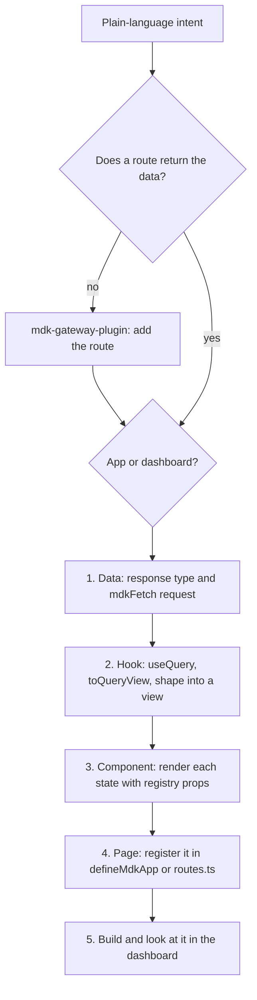

# Build MDK UI for Worker and plugin data (`mdk-ui-component`)

## Overview

MDK UI is composition only. A Gateway route serves the data, a hook fetches it and shapes it into a view, a
presentational component renders the view with `@tetherto/mdk-react-devkit`, and a thin page wires them together.
This skill builds that chain in either place MDK UI lives. It never invents a component or a prop: every devkit
component and its props come from [`references/ui-registry.json`](./references/ui-registry.json), and every helper or
hook (`buildBarChartOptions`, `usePeriod`) from the installed package's type declarations (`dist/*.d.ts`).

## Choose where the UI lives

| The UI belongs to                                             | Build it in                         | Registered by                                       | Read next                                                          |
| ------------------------------------------------------------- | ----------------------------------- | --------------------------------------------------- | ------------------------------------------------------------------ |
| An MDK App (installed with `mdk add app`, serves its own routes) | The app's `ui-src/`, built to `ui/` | `routes`, `panels` and `sections` in `defineMdkApp` | [`references/app-ui-module.md`](./references/app-ui-module.md) |
| A site's own dashboard (`mdk create dashboard`)               | `apps/dashboard/src/`               | One line in `src/routes.ts`                         | [`references/page-recipe.md`](./references/page-recipe.md)        |

Build in the app when the data comes from the app's own routes. Its pages then install with it, under `/app/<name>/`,
on any dashboard, and its Home panel shows on the dashboard's landing page.

## Prerequisites

1. **The route exists, or its response is agreed.** If no route returns the data, use `mdk-gateway-plugin` to add
   one, or agree its response body with whoever writes it and type the data layer from that. Call the route once
   it serves, and confirm the JSON shape matches.
2. **The units are known.** Read the Worker's `mdk-contract.json` so labels and units match the channel (`power` is
   `W`). Resolve it from `mdk.yaml` `spec.workers[].package`: `<package>/mdk-contract.json`, or the same under
   `node_modules/<package>/`.
3. **The host exists.** For an app, `mdk create app <name>` scaffolds `ui-src/` with a working page, hook and Home
   panel (`mdk-create-app`). For a dashboard, run `mdk create dashboard` (`mdk-deployment`).

## Workflow



### 1. Data: the request and its type

One module per route, with no React: the response type, the query key and the request. `mdkFetch` from
`@tetherto/mdk-ui-foundation` sends the signed-in operator's token and throws `MdkFetchError` with the status on a
non-2xx answer.

```ts
// ui-src/data/thing.ts
import { mdkFetch } from '@tetherto/mdk-ui-foundation'

/** What `GET /api/<name>/thing` returns (`plugin/controllers/thing.js`). */
export type Thing = { unit: string; total: number; devices: Array<{ id: string; value: number }> }

export const thingQueryKey = (url: string) => ['<name>', 'thing', url] as const

/** GET the thing, with the signed-in operator's token. */
export const fetchThing = (url: string): Promise<Thing> => mdkFetch<Thing>(url)
```

When the app keeps its route bodies as schemas (zod, say), parse the body here, `thingSchema.parse(await
mdkFetch(url))`, so a response that drifts from the contract fails at this boundary instead of in a component.

### 2. Hook: fetch and shape into a view

The hook returns a view the component can switch on, never raw query state. `toQueryView` turns the query into
`loading`, `error` (one line that says why) or `ready`; the hook then shapes `ready` data into exactly what renders.

```ts
// ui-src/hooks/use-thing.ts
import { toQueryView, useMdkApp, useQuery } from '@tetherto/mdk-react-adapter'

import { fetchThing, thingQueryKey } from '../data/thing'

const THING_REFETCH_MS = 30_000

export type ThingView =
  | { status: 'loading' }
  | { status: 'error'; message: string }
  | { status: 'empty' }
  | { status: 'ready'; total: string; devices: Array<{ id: string; value: string }> }

export const useThing = (): ThingView => {
  // The operator picks the app's installed name, so the URL comes from useMdkApp().
  const { apiUrl } = useMdkApp()
  const url = apiUrl('/api/<name>/thing')
  const query = useQuery({
    queryKey: thingQueryKey(url),
    queryFn: () => fetchThing(url),
    refetchInterval: THING_REFETCH_MS,
  })
  const view = toQueryView(query, url, { unreachableHint: 'Start the stack with `mdk run`.' })
  if (view.status !== 'ready') return view
  if (view.data.devices.length === 0) return { status: 'empty' }
  const { unit, total, devices } = view.data
  return {
    status: 'ready',
    total: `${total} ${unit}`,
    devices: devices.map((d) => ({ id: d.id, value: `${d.value} ${unit}` })),
  }
}
```

- Import `useQuery`, `useMutation` and `useQueryClient` from `@tetherto/mdk-react-adapter`, never from
  `@tanstack/react-query`.
- Put every input the request depends on (the period, a filter) in the `queryKey`.
- Move shaping that is more than a few lines into a pure `<thing>-shape.ts` with no React, so it can be unit-tested
  (the scaffold has no test runner; add Vitest to `ui-src/` for it).
- In a dashboard page there is no `useMdkApp`: build the URL from `useMdkContext().apiBaseUrl` instead.

### 3. Component: render each state

Props in, markup out: no fetching, no stores, no shaping beyond display. Handle every state the view has.

```tsx
// ui-src/components/thing-panel.tsx
import { EmptyState, ErrorCard, Loader, SingleStatCard } from '@tetherto/mdk-react-devkit'

import type { ThingView } from '../hooks/use-thing'

export const ThingPanel = ({ view }: { view: ThingView }) => {
  switch (view.status) {
    case 'loading':
      return <Loader />
    case 'error':
      return <ErrorCard title="Could not load the thing" error={view.message} />
    case 'empty':
      return <EmptyState description="No devices report this yet." size="sm" />
    case 'ready':
      return <SingleStatCard name="Total" value={view.total} />
  }
}
```

Pick components from the registry: `indexes.componentsByName` gives the entry, and its `props` are the only props
that exist. Prefer entries with `tier: "agent-ready"`.

| Need                                          | Component                                  |
| --------------------------------------------- | ------------------------------------------ |
| One figure, with a caption, tag or detail     | `SingleStatCard`                           |
| A titled card with loading and empty states   | `ChartContainer`                           |
| Bars over time buckets                        | `BarChart` with `buildBarChartData` and `buildBarChartOptions` |
| A time series                                 | `LineChartCard`                            |
| Rows with sorting                             | `DataTable`                                |
| A report's period and bucket size             | `PeriodControl` (with `usePeriod`)         |
| A CSV export                                  | `ExportButton` (with `toCsv`, `downloadCsv`) |
| Loading, error and empty                      | `Loader`, `ErrorCard`, `EmptyState`        |
| A two- or three-way toggle                    | `CurrencyToggler`                          |
| Text                                          | `Typography`                               |

[`references/report-patterns.md`](./references/report-patterns.md) shows the period, charts, tiles, formatting and
CSV export put together.

### 4. Page: wire it and register it

The page reads the hook and hands the view to the component. In an app, register it in `ui-src/index.tsx`:

```tsx
import { defineMdkApp, MDK_APP_PANEL_SLOT } from '@tetherto/mdk-react-adapter'
import { OperationsNavIcon } from '@tetherto/mdk-react-devkit'

import { ThingPanel } from './components/thing-panel'
import { useThing } from './hooks/use-thing'
import './styles.css'

const ThingPage = () => <ThingPanel view={useThing()} />

export default defineMdkApp({
  id: 'io.tether.<name>', // must equal `id` in mdk-app.yaml
  displayName: '<Display Name>',
  routes: [{ path: 'thing', label: 'Thing', section: 'Operations', component: ThingPage }],
  sections: [{ label: 'Operations', icon: OperationsNavIcon }],
  panels: [{ id: 'thing', slot: MDK_APP_PANEL_SLOT.HOME, title: 'Thing', component: ThingPage }],
})
```

In a dashboard, add the page under `src/pages/`, wrap it in `PageLayout`, and append one line to `src/routes.ts`
([`references/page-recipe.md`](./references/page-recipe.md)).

### 5. Build and verify

- **App:** run `npm run build:ui` in the app, then commit `ui/`. A GitHub install runs no build, so a stale `ui/`
  ships stale code.
- **Run it:** start the stack and the dashboard (`mdk run`, `mdk run dashboard`), open the page (`/app/<name>/thing`
  for an app), and check each state: data, empty, and an error with the app's runtime stopped.

## Rules

| Don't                                                        | Do                                                                                 |
| ------------------------------------------------------------ | ---------------------------------------------------------------------------------- |
| Call `fetch` in a component, or a bare `fetch` anywhere      | A hook, with `mdkFetch` in the data layer (a bare `fetch` sends no token)          |
| Hardcode `/apps/<name>/...`                                  | `useMdkApp().apiUrl('/api/...')`                                                   |
| Return `{ data, isLoading, error }` from a hook              | A view union from `toQueryView`                                                    |
| Guess a prop                                                 | Its entry in [`references/ui-registry.json`](./references/ui-registry.json)        |
| Import `@tetherto/mdk-react-devkit/<path>` in an app         | The package root: the dashboard shares only root specifiers with apps              |
| Bundle React or the MDK packages into an app                 | Keep `MDK_APP_SHARED_MODULES` external in `ui-src/vite.config.ts`                  |
| Import Ant Design, MUI or another UI kit                     | `@tetherto/mdk-react-devkit`                                                       |
| Hold a report's range in `useState`                          | `usePeriod` and `PeriodControl`, so the period lives in the URL                    |
| Hardcode a unit the contract or payload gives                | The `unit` from the payload or the Worker contract                                 |
| Edit `router.tsx` for a dashboard page                       | One line in `src/routes.ts`                                                        |

## Self-audit

- [ ] Every request goes through `mdkFetch`, and every app URL through `useMdkApp().apiUrl`.
- [ ] Every hook returns a view union, and every component renders each of its states.
- [ ] Every devkit component and prop exists in [`references/ui-registry.json`](./references/ui-registry.json).
- [ ] Devkit imports use the package root.
- [ ] An app's `defineMdkApp` `id` equals `id` in `mdk-app.yaml`, and `ui/` is rebuilt and committed.
- [ ] The page was opened in a running dashboard, with data and with the runtime stopped.

## Next steps

- [Add the route the UI reads](../mdk-gateway-plugin/SKILL.md): `mdk-gateway-plugin`, when no route serves the data
- [Scaffold the app that hosts the UI](../mdk-create-app/SKILL.md): `mdk-create-app`, for `ui-src/` and the manifest
- [Run the stack and the dashboard](../mdk-deployment/SKILL.md): `mdk-deployment`, when the app is not running
- [Expose a missing telemetry channel](../mdk-worker-plugin/SKILL.md): `mdk-worker-plugin`, when the device lacks it
